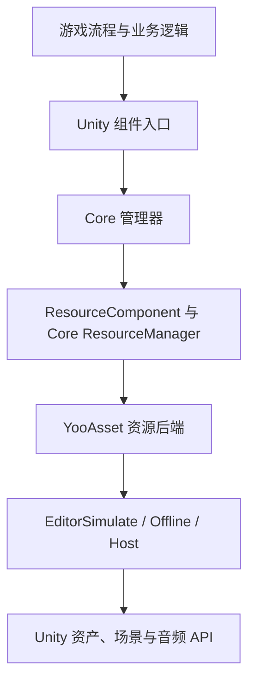
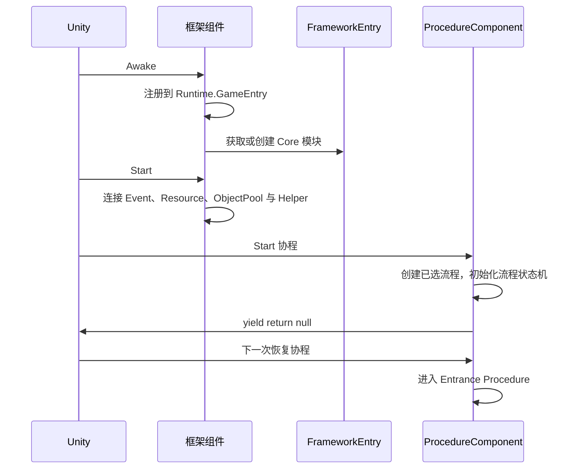

# 从点击 Play 到进入战斗

先打开 StarForce Launcher，点击 Play。框架完成初始化后显示菜单，点击“开始”进入战斗。这个过程中，Unity 并没有替我们依次执行“读表、加载场景、创建飞机”；这些工作由组件、流程和模块共同完成。

本文按当前仓库的代码解释这条调用链。下文的 Core 指 `UnityQGameFramework.Core`，Unity 适配层指 `UnityQGameFramework.Runtime`。示例中的 `StarForce.GameEntry` 是另外一个业务入口。

## 1. 三层代码分别管什么

| 位置           | 负责的事情                                                                      | 不应该放进去的东西                               |
| -------------- | ------------------------------------------------------------------------------- | ------------------------------------------------ |
| Runtime/Core   | 状态机、事件队列、对象池、加载调度、引用与缓存管理                              | GameObject、Inspector、UnityWebRequest、游戏玩法 |
| Runtime/Unity  | MonoBehaviour 生命周期、Unity 资源与场景 API、AudioSource、组件配置、默认辅助器 | 道具价格、敌人波次、关卡规则                     |
| 自己的游戏目录 | 流程、实体逻辑、UI、业务数据与资源命名                                          | 复制一份框架模块的内部实现                       |

Core 的 asmdef 设置了 `noEngineReferences: true`，不引用 Unity 引擎程序集。它能管理“有一个界面正在加载”，却不会自己调用 `Object.Instantiate`。实例化这一步由 Unity 层的 `DefaultUIFormHelper` 执行。



这不是一次单向调用。异步任务完成后，辅助器通过接口事件通知管理器，管理器更新自己的记录，组件再将结果转成游戏可订阅的事件。

## 2. 游戏代码先用 QGF，再按需要往下看

平时读取配置或创建状态机，可以直接写：

```csharp
using UnityQGameFramework.Runtime;

var events = QGF.Event;
var fsm = QGF.Fsm;
```

`QGF` 位于包内 `Runtime/Unity/Base/QGF.cs`。每个属性从 Runtime.GameEntry 的组件缓存取得当前组件，返回值仍是原来的组件类型；例如 `QGF.Config.ReadData(...)` 调用的就是 ConfigComponent。它没有另建模块，也不需要自己的初始化脚本。

这个封装只缩短写法。场景仍需有框架组件，Config、Resource 等仍需完成 Start；入口 Procedure 或示例中 await 下一帧的 async Start 都是合适的调用位置。缺少组件时属性会给出包含组件类型的错误。确实需要允许组件不存在时，用下面的 GameEntry 查询接口判断 null。

三个入口分别用于 Core 模块、Unity 组件和 StarForce 业务组件：

### FrameworkEntry：取得 Core 模块

```csharp
using UnityQGameFramework.Core;
using UnityQGameFramework.Core.Event;

IEventManager events = FrameworkEntry.GetModule<IEventManager>();
```

第一次调用时，`FrameworkEntry` 根据接口名找到具体实现，例如 `IEventManager → EventManager`，创建一个实例，加入模块链表并缓存。以后按同一接口取得的是同一个模块。

它要求传入框架 Core 的接口，并按约定寻找实现类。它不是任意业务对象的依赖注入容器；不能用它注册、获取自己的 `IInventorySystem`，也不能传入 `EventComponent`。

这个入口延续自 UGF。当前 QGF 增加了类型缓存，保留了模块创建和统一轮询的方式；它不是从 QFramework 的 Architecture 迁来的。

Unity 组件通常把调用交给同一份 Core 管理器。有些组件入口还负责补充 Unity 参数，例如 Entity 的逻辑类型、Sound 的绑定实体和坐标。Core 中省略优先级、上下文等参数的重载，会转到参数完整的实现；阅读时把这些重载看成同一个功能组。

组件初始化时也会调用管理器的 SetResourceManager、SetObjectPoolManager 和各模块的 Helper 设置接口，连接依赖。平时通过 QGF 使用功能；编写纯 C# 宿主或自定义适配层时，再按模块接口完成这些连接。

### Runtime.GameEntry：取得场景组件

```csharp
using UnityQGameFramework.Runtime;

EventComponent events = GameEntry.GetComponent<EventComponent>();
```

它只查找已经注册的组件。找不到时返回 `null`，不会创建 GameObject，也不会自动拖入框架预制体。组件按具体类型登记，同一类型不应该放两份。

### StarForce.GameEntry：示例自己的快捷访问

StarForce 在业务入口里缓存了 `Base`、`Resource`、`Scene`、`Entity` 等组件，所以示例代码可以写 `GameEntry.Entity.ShowEntity(...)`。

这是示例对 Runtime.GameEntry 的封装。现在自己的游戏直接使用包内 `QGF.Entity`、`QGF.UI` 即可；StarForce 还保留了管理自己的 HPBar、BuiltinData 等业务组件的入口。阅读示例时先看 namespace，避免把业务入口与框架入口混在一起。

## 3. Awake、Start 和启动流程

框架预制体包含 Base、Event、Resource、Procedure 等节点。它们是 Unity 组件，不是 Core 管理器本身。



`FrameworkComponent.Awake()` 先注册自己。各组件覆盖 Awake 时调用 `base.Awake()`，再获取对应 Core 模块。Base 还会初始化日志、JSON、压缩等工具的辅助器。

组件的 Start 才完成许多跨模块连接。例如 Entity 将 Resource、ObjectPool 和 EntityHelper 交给 EntityManager；UI 创建界面实例根节点和分组；Config 设置配置读取辅助器。

GameEntry 查询返回的是已注册组件。模块在各自的 Start 中完成初始化；需要资源、实体、UI 或配置的启动逻辑放在入口 Procedure 的 OnEnter 中。

ProcedureComponent 先初始化流程，再 `yield return null`，随后进入入口流程。它等的是其他组件的 Start，不依赖 Game 视图是否完成渲染。自己的普通 MonoBehaviour 如果也要在启动时调用这些模块，应由启动流程显式通知，或等待明确的业务就绪状态。

## 4. 谁在每帧更新 Core

`BaseComponent.Update()` 调用：

```csharp
FrameworkEntry.Update(Time.deltaTime, Time.unscaledDeltaTime);
```

FrameworkEntry 按优先级从高到低遍历已创建的模块。当前显式优先级如下：

| 模块                       | 优先级 | 作用                                             |
| -------------------------- | -----: | ------------------------------------------------ |
| Event                      |      7 | 分发排队事件                                     |
| ObjectPool                 |      6 | 处理自动释放等池维护                             |
| Download                   |      5 | 推进下载任务                                     |
| FileSystem                 |      4 | 文件系统维护                                     |
| Resource                   |      3 | 推进资源任务                                     |
| Scene                      |      2 | 场景管理维护                                     |
| Fsm                        |      1 | 更新状态机，也在这里更新当前 Procedure           |
| 其他未覆盖 Priority 的模块 |      0 | 使用各自的 Update 实现，部分为空                 |
| Debugger                   |     -1 | 调试窗口更新                                     |
| Procedure                  |     -2 | 流程管理器自身的 Update；流程状态实际由 Fsm 驱动 |

相同优先级按创建时的插入顺序排列；业务依赖应通过模块接口表达。模块更新由 BaseComponent 统一驱动，普通业务脚本无需再次调用 `FrameworkEntry.Update()`。

Event.Fire 将参数入队，Event.Update 轮询队列并派发。FireNow 在调用处同步执行接收函数，Unity 项目从主线程调用。

`elapseSeconds` 受 timeScale 影响；`realElapseSeconds` 不受影响。游戏暂停时，框架仍会得到 Update 调用。某项工作是否继续，取决于该模块或自己的状态使用哪一个时间参数，不能把“暂停游戏”理解为暂停全部下载、网络和界面逻辑。

## 5. 一次界面加载怎样经过几个模块

假设游戏打开背包界面：

1. 游戏调用 `UIComponent.OpenUIForm`，传入完整资源路径、分组和 userData；界面预制体上挂有自己的 UIFormLogic。
2. UIManager 分配界面序列号，先检查实例池能否复用该资源的对象。
3. 需要新实例时，UIManager 向 Resource 请求预制体。
4. 编辑器通过 ResourceSettings 对应的 ResourceBuildProfile 加载 YooAsset 模拟包；Player 使用同一配置中的 Offline 或 Host 包设置。
5. 资源成功返回后，UIFormHelper 创建预制体实例，UIForm 取得预制体上已有的 UIFormLogic 并初始化。
6. UIManager 将界面加入 UIGroup，处理深度、暂停和覆盖关系，调用 OnOpen。
7. UIComponent 将成功或失败转换为 EventComponent 的事件。业务根据 userData 判断结果是否属于自己。
8. CloseUIForm 后执行 OnClose，实例返回内部对象池；并不保证当场销毁 GameObject。

Entity 的显示和隐藏与这条链路相似。Sound 也是通过 Resource 取 AudioClip，再交给声音组中的代理播放。Scene 则将加载、卸载任务交给资源接口处理。

因此，“直接销毁框架生成的飞机或界面”会绕过管理器的记录。正常退出时应分别调用 HideEntity、CloseUIForm、StopSound、UnloadScene 等对应入口。

## 6. StarForce 的启动路线

编辑器模拟包下，主要流程为：

```text
ProcedureLaunch
  读取内置 BuildInfo，初始化语言、声音、内置字典
    ↓
ProcedureSplash
  判断资源模式
    ↓
ProcedurePreload
  加载 DefaultConfig、Luban Tables、语言字典和字体
    ↓
ProcedureChangeScene
  从 Scene 表找到 Menu 的资源路径，异步加载
    ↓
ProcedureMenu
  打开 MenuForm，等待玩家点击开始
    ↓
ProcedureChangeScene
  卸载已加载的游戏场景，加载 Main
    ↓
ProcedureMain
  创建具体玩法，显示玩家飞机并推进战斗
```

这里的多个“完成”不是同一件事。场景加载完成不等于玩家实体已经显示；进入主流程不等于 UI 已打开。每个异步入口都要等待自己的完成通知。

Player 使用 ResourceSettings 中的 Offline 或 Host 配置，并按游戏流程初始化资源包、检查版本或下载资源。不要把编辑器模拟包的试玩当成 Player 资源链路已经通过。

## 7. Config、DataTable、Setting 和 DataNode 有什么区别

| 需求                         | 使用哪个模块              | 数据来自哪里                                | 是否用于保存玩家改动 |
| ---------------------------- | ------------------------- | ------------------------------------------- | -------------------- |
| 游戏参数，例如默认场景编号   | Config                    | 运行时加载的 TOML 文本                      | 否                   |
| 道具、敌人、关卡等结构化配置 | DataTable                 | Luban 生成代码、bytes 与 Catalog            | 否                   |
| 音量、语言等本地偏好         | Setting                   | 默认辅助器读写本地 GameFrameworkSetting.dat | 是，显式 Save        |
| 一场战斗中的临时共享数据     | DataNode 或自己的业务对象 | 内存                                        | 否，退出后不保留     |

Config 与 DataTable 分别通过资源接口读取数据。Setting 使用独立文件保存玩家设置。

## 8. 退出时谁负责清理

Base 被销毁时会调用 `FrameworkEntry.Shutdown()`，按模块更新顺序的反方向关闭模块，然后清除模块缓存、ReferencePool 和缓存的非托管内存。Runtime.GameEntry 的组件登记也会清空。

业务仍应在自己的生命周期结束时取消订阅、关闭界面、隐藏实体、终止请求。等到整个框架 Shutdown 才清理，会让已经离开的业务继续收到回调。

框架根节点需要跨场景保留时，由项目安排持久化和加载方式。不要在每个游戏场景重复放入一套框架预制体；一个 Base 被销毁就会触发静态 Core 的关闭。

## 9. 什么时候需要自己写 Helper

Helper 把 Core 的接口连接到 Unity 或项目自己的实现。Inspector 中的 Helper 类型通常要继承对应的 `*HelperBase`；需要预制体的 Helper 也在组件里指定。Base 中的日志、版本、JSON 等工具辅助器则通过类型名创建。

| 契约 | 默认实现或示例 | 需要替换的情况 |
| --- | --- | --- |
| IEntityHelper / IUIFormHelper | DefaultEntityHelper / DefaultUIFormHelper | 改变实体或界面的实例化、创建与释放方式 |
| IEntity / IUIForm | Runtime.Entity / UIForm | Unity 默认实现把生命周期转给 EntityLogic / UIFormLogic；业务继承 Logic |
| IEntityGroupHelper / ISoundGroupHelper / IUIGroupHelper | 对应 Default*GroupHelper | 创建组节点；UI 组辅助器另提供深度变化入口 |
| ISoundHelper / ISoundAgentHelper | DefaultSoundHelper / DefaultSoundAgentHelper | 更换声音资源释放方式或播放后端 |
| IResourceHelper / ILoadResourceAgentHelper | DefaultResourceHelper / DefaultLoadResourceAgentHelper | 更换字节、场景或资源包的读取、解析和释放方式 |
| IDownloadAgentHelper / IWebRequestAgentHelper | UnityWebRequestDownloadAgentHelper / UnityWebRequestAgentHelper | 更换下载、HTTP 请求后端 |
| ISettingHelper | DefaultSettingHelper；Setting 示例继承它改变文件位置 | 更换玩家设置的存储与序列化方式 |
| IFileSystemHelper | DefaultFileSystemHelper | 更换文件容器使用的流实现 |
| ILocalizationHelper | DefaultLocalizationHelper | 改变系统语言的判定；字典内容仍由读取流程处理 |
| INetworkChannelHelper / IPacketHeader / IPacketHandler | Network 示例的 NetworkTextProtocol、Header 和 NetworkTextHandler | 定义包头、编解码、心跳与消息处理 |
| ILogHelper / IVersionHelper | DefaultLogHelper / DefaultVersionHelper | 改变日志输出或游戏版本来源 |
| IDebuggerWindow | Debugger 示例的 CounterWindow | 增加自己的调试页面 |

EntityGroupHelper 和 SoundGroupHelper 的 Core 接口没有方法，是组辅助对象的类型约束。它们不负责查询实体或播放声音；查询和配置分别由 IEntityGroup、ISoundGroup 提供。UIGroupHelper 另有 SetDepth，默认实现为空；当前示例在 UIFormLogic.OnDepthChanged 中更新 Canvas.sortingOrder。

Download、WebRequest、资源加载和声音代理 Helper 的事件供内部代理消费，推进任务、报告进度或回收声音。业务使用组件提供的通知和查询；这些代理事件并不逐一对应 Runtime 事件。例如 ResetSoundAgent 用于归还声音代理。

`IEntity`、`IUIForm` 的 OnInit 是 Core 的初始化入口；Unity 层会决定是否创建或复用 Logic。EntityLogic.OnInit 在创建该逻辑时调用，UIFormLogic.OnInit 在新界面实例上调用；每次显示、打开时的业务数据放在 OnShow、OnOpen。Handle 在这两个 Unity 实现中都是 GameObject。

`IReference.Clear()` 不是 Helper，它在引用归还时重置内容，示例见 ReferencePool。数据表行已不再要求实现 IDataRow；具体键由 Luban schema 定义，生成表继承 DataTable<T> 提供公共查询。

可从 [Entity](Modules/entity.md)、[UI](Modules/ui.md)、[Network](Modules/network.md)、[Setting](Modules/setting.md) 和 [Debugger](Modules/debugger.md) 的现有示例继续查看实现。

## 10. 继续阅读

- [安装与创建启动流程](01-getting-started.md)
- [项目约定和资源所有权](03-conventions.md)
- [QGF 相对 UGF 的改动](04-changes-from-ugf.md)
- [按模块查找示例](Modules/README.md)

本文对应的主要源码：[FrameworkEntry](../Runtime/Core/Base/FrameworkEntry.cs)、[FrameworkModule](../Runtime/Core/Base/FrameworkModule.cs)、[BaseComponent](../Runtime/Unity/Base/BaseComponent.cs)、[Runtime.GameEntry](../Runtime/Unity/Base/GameEntry.cs)、[ProcedureComponent](../Runtime/Unity/Procedure/ProcedureComponent.cs)。
