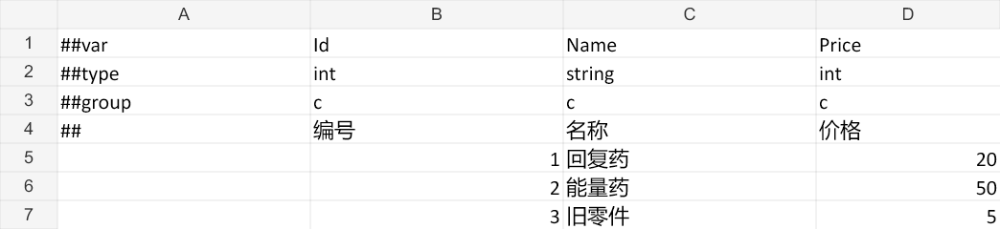

# 用 Luban 制作与读取配置表

从默认 Item 表增加价格列，生成 C# 和 bytes，再按 Id、条件和排序查询。文末说明如何添加 Weapon 表。

如果还没有完成安装，请先阅读 [安装与第一个流程](01-getting-started.md)。下面使用默认工作区 `Assets/UnityQGameFramework/Config`，示例项目自己的工作区在 StarForce 目录内，操作方式相同。

## 1. 一张表怎样进入游戏

QGF 使用官方 Luban 5.1.0 编译表格，流程如下：

```text
Excel 表定义 + Excel 数据 + luban.conf
                  ↓ QGF > Generate Tables
        Generated/*.cs + Data/*.bytes
                              ↑
                       Data/Catalog.asset
                              ↓ DataTableComponent.LoadDataTables
                    Luban 强类型表对象
                              ↓
                      游戏代码查询记录
```

Excel 是编辑数据的地方；C# 定义运行时类型；bytes 保存具体数值；Catalog 将这一组 bytes 与生成代码的结构版本对应起来。游戏运行时不打开 Excel，也不读取 Profile。

旧 UGF 的 TXT 解析器、逐行解析方法和表代码生成器已移除。现在的数据生产使用 Luban，游戏调用仍通过 QGF 的 DataTable 组件。

## 2. 先看清四个 Excel

打开 `Source/Datas`，初始内容有四个工作簿：

| 文件                  | 用途                                       |
| --------------------- | ------------------------------------------ |
| __tables__.xlsx | 登记表名、记录类型、数据来源、主键和表模式 |
| __beans__.xlsx  | 定义可复用的结构，例如奖励、坐标、消耗     |
| __enums__.xlsx  | 定义枚举，例如品质、阵营、道具种类         |
| Item.xlsx             | Item 表的字段与具体数据                    |

前后三个 schema 文件名两边各是两个下划线。初始 Item 表直接从数据工作表读取字段定义，因此 `__beans__` 和 `__enums__` 可以只有标题，不需要填一份重复的 DRItem。

打开 `__tables__.xlsx`，初始记录的关键列是：

| full_name | value_type | read_schema_from_file | input          | index | mode |
| --------- | ---------- | --------------------- | -------------- | ----- | ---- |
| TbItem    | DRItem     | 1                     | Item@Item.xlsx | Id    | map  |

它的意思是：创建名为 TbItem 的表，记录类型为 DRItem，从 Item.xlsx 中的 Item 工作表读取；字段定义也在这个工作表里；按 Id 建立 map 索引。

这里的 Item 是工作表页签名，不是自动推断的文件名。`工作表名@文件名.xlsx` 左右写反会找不到输入。

生成后出现的三个类型分工如下：

| 类型   | 内容                                           |
| ------ | ---------------------------------------------- |
| DRItem | 一条道具记录，含 Id、Name 等字段               |
| TbItem | 一整张道具表，以及 Luban 生成的索引            |
| Tables | 当前 target 下的全部表，负责读取和解析跨表引用 |

TbItem 是 `__tables__` 中登记的表类。

## 3. 给 Item 加上价格

用 Excel 或其他支持 XLSX 的表格工具打开 `Item.xlsx`。保持工作表名为 **Item**。

把工作表调整为：

| A       | B    | C      | D     |
| ------- | ---- | ------ | ----- |
| ##var   | Id   | Name   | Price |
| ##type  | int  | string | int   |
| ##group | c    | c      | c     |
| ##      | 编号 | 名称   | 价格  |
|         | 1    | 回复药 | 20    |
|         | 2    | 能量药 | 50    |
|         | 3    | 旧零件 | 5     |

`##var` 是生成字段名，`##type` 是 Luban 类型，`##group` 表示导出分组，`##` 这一行写给人看。没有标记的后续行才是数据。第一列的数据单元格留空，Id 从第二列开始。

初始配置使用客户端组 `c`。如果一列不属于目标导出分组，生成结果中可能没有这个字段；增加字段时一起填写 group。

保存并关闭文件，再执行 `QGF > Generate Tables`。关闭 Excel 可以避免某些表格工具对工作簿施加文件锁。



上图是同一份示例工作簿的渲染预览，字段和值已用官方 Luban 编译验证；不是 Unity Inspector 截图。

成功后检查：

```text
Generated/DRItem.cs       新增 readonly int Price
Generated/TbItem.cs       仍是一张表
Generated/Tables.cs       仍是整组入口
Data/tbitem.bytes         包含三条新数据
Data/Catalog.asset       记录本次生成的表资源
```

不要手改 Generated 中的字段，下一次会覆盖。修改源表、重新生成，才是可重复的工作方式。

## 4. 加载，再查询

先把 `Data/Catalog.asset` 拖入场景 DataTable 节点的 **Luban Catalog**，在启动或预加载流程中调用：

```csharp
var dataTable = QGF.DataTable;
dataTable.LoadDataTables(loader => new Tables(loader));
```

这里的 `GameEntry` 来自 `UnityQGameFramework.Runtime`，`Tables` 来自默认命名空间 `UnityQGameFramework.Config`。第一次示例中的 GameStartup 就是一个完整可运行的加载例子。

这种 Inspector 引用方式会同步解析 Catalog 已引用的二进制，并发布整组表。调用结束后先检查加载是否成功：

```csharp
if (!dataTable.HasDataTable<TbItem>()) return;

var items = dataTable.GetDataTable<TbItem>();
var potion = items.GetDataRow(1);
if (potion != null) Log.Info($"{potion.Name}：{potion.Price}");
```

Id 是业务主键，不是 Excel 物理行号。Id 为 1 的记录放到第十行，查询仍然是 `GetDataRow(1)`。不存在的 Id 返回 null。

### 条件查询

下面代码接着上一段的 `items` 使用：

```csharp
bool hasCheapItem = items.HasDataRow(row => row.Price <= 20);
var firstCheapItem = items.GetDataRow(row => row.Price <= 20);
var cheapItems = items.GetDataRows(row => row.Price <= 20);
var sorted = items.GetDataRows((a, b) => a.Price.CompareTo(b.Price));
var cheapSorted = items.GetDataRows(
    row => row.Price <= 20,
    (a, b) => a.Price.CompareTo(b.Price));
```

有多条匹配记录时，`GetDataRow(condition)` 只返回其中第一条。业务需要明确的先后顺序时，使用筛选加排序。

### 复用列表与 LINQ

频繁调用时可复用结果列表，避免每次创建结果数组：

```csharp
var result = new System.Collections.Generic.List<DRItem>();
items.GetDataRows(row => row.Price <= 20, result);
```

表实现了 `IEnumerable<T>`，可以 foreach，也可添加 `using System.Linq;` 后使用：

```csharp
var names = items.Where(row => row.Price <= 20)
                 .OrderBy(row => row.Price)
                 .Select(row => row.Name)
                 .ToArray();
```

条件查询会遍历记录。频繁查询大表时，在 Luban schema 中定义索引。

其他常用属性有 `Count`、`DataMap`、`DataList`；`GetAllDataRows()` 取得全部记录。需要最小或最大键时，在业务侧按键字段比较。

## 5. 再添加一张 Weapon 表

复制 Item.xlsx 为 Weapon.xlsx，将其中工作表页签改成 **Weapon**，内容改为：

| A       | B    | C      | D      |
| ------- | ---- | ------ | ------ |
| ##var   | Id   | Name   | Attack |
| ##type  | int  | string | int    |
| ##group | c    | c      | c      |
| ##      | 编号 | 名称   | 攻击力 |
|         | 101  | 轻型炮 | 10     |
|         | 102  | 重型炮 | 30     |

在 `__tables__.xlsx` 的 Item 登记下增加一条：

| full_name | value_type | read_schema_from_file | input              | index | mode |
| --------- | ---------- | --------------------- | ------------------ | ----- | ---- |
| TbWeapon  | DRWeapon   | 1                     | Weapon@Weapon.xlsx | Id    | map  |

其余可选列保持空白，保存后生成。现在会增加 DRWeapon.cs、TbWeapon.cs 和 tbweapon.bytes，Tables 中增加 TbWeapon，Catalog 也多一项。组件已有的 Catalog 引用会跟随同一个资产更新，不必每增加一张表就拖一次。

加载 Tables 的代码不变，查询改成：

```csharp
var weapons = dataTable.GetDataTable<TbWeapon>();
var weapon = weapons.GetDataRow(101);
```

## 6. 数组、结构、引用和其他主键

所有表统一从 `GetDataTable<TbXxx>()` 取得，返回的就是 Luban 生成表。`DataMap`、`DataList`、生成的索引和 QGF 条件查询使用同一份记录。

- map 表按实际键类型生成 `GetDataRow(key)` 和 `HasDataRow(key)`，支持字符串、长整数、枚举，以及名称不是 Id 的主键。
- 复合索引的 list 表生成 `GetDataRow(key1, key2, ...)`；多个独立索引保留 Luban 的 `GetByXxx`。
- 无主键的 list 表使用 `DataList`、枚举和条件查询；one 表使用 `Data`，其行数为 1。
- 所有表都在整组构造、引用解析和版本校验成功后登记。跨表引用属性直接指向被引用记录。

`GetDataRow(key)` 在缺键时返回默认值：class 为 null，struct 为其默认值。原生 `Get` 和索引器保留 Luban 的缺键行为。one 表字段与表元数据重名时从 `Data` 读取，例如 `rules.Data.Count`；`rules.Count` 始终是行数。

同一行结构用于多张表时，分别使用各自的 `TbXxx` 类型查询。需要登记同一种表的额外实例时，可在生成表的构造函数传入 name，再通过 `GetDataTable<TbXxx>(name)` 查询。

## 7. Profile、全局选择和 Catalog

这三个概念解决的是不同问题：

| 名称                  | 谁读取           | 决定什么                           |
| --------------------- | ---------------- | ---------------------------------- |
| LubanProfile          | 编辑器生成工具   | 源表、C# 输出、数据输出与 target   |
| 全局 Profile          | 菜单与 Inspector | 本次点击生成时使用哪份 Profile     |
| LubanDataTableCatalog | 运行时组件       | 加载哪组 bytes，以及它们的结构版本 |

Profile 放在 `Editor/LubanProfile.asset`，字段为：

| 字段          | 内容                                 |
| ------------- | ------------------------------------ |
| Source Folder | 包含 luban.conf 的目录               |
| Code Folder   | 生成 C# 的目录                       |
| Data Folder   | 生成 bytes 与 Catalog 的目录         |
| Target        | luban.conf 中的目标名称，默认 client |

源表、代码、数据目录必须相互独立，不能彼此嵌套。Extensions 放手写代码，不用指定为生成目录。

全局选择位于 `QGF > Settings > Profile`，也可在 DataTable Inspector 选择 Profile 后点 **设为全局**。设置保存在 `ProjectSettings/UnityQGameFrameworkSettings.asset`，团队应一起提交。

Catalog 保存生成文件名与 TextAsset 的对应关系。组件据此读取 bytes，交给 `new Tables(loader)`；构造、跨表引用解析和版本校验成功后登记全部生成表。

全局 Profile 改成默认配置后，StarForce 仍能运行，是因为 Launcher 的 Catalog 仍然引用示例数据。这是明确的两个选择。需要改变运行时数据时，先生成目标 Profile，再在组件点击 **使用全局 Catalog**，或手动拖入目标 Catalog。

### 命名空间在哪里改

打开 `Source/luban.conf`，找到 targets：

```json
"targets": [
  {
    "name": "client",
    "manager": "Tables",
    "groups": ["c"],
    "topModule": "MyGame.Config"
  }
]
```

`name` 与 Profile.Target 对应；`manager` 决定总入口类名；`topModule` 是命名空间；`groups` 决定导出分组。Profile Inspector 会显示这几个值，点击 **编辑配置** 可打开原文件。

修改后重新生成，同时修改业务 using 和 Extensions 中 partial 类的命名空间。同一游戏中保留两套配置时，给它们不同命名空间，例如 MyGame.Config 与 StarForce，避免生成类型重复。

## 8. 生成会覆盖哪些文件

生成使用覆盖更新：更新本 Profile 登记过的生成文件，并删除本 Profile 不再生成的旧文件，保留已有 `.meta`。不会先清空整个输出目录。

Profile 中隐藏的生成文件清单和输出目录 GUID 用来确认归属。第一次指向一个已有同名文件的陌生目录时，工具会拒绝覆盖；更换目录不是取得该目录全部文件的写入权限。

修改 Excel 数值后应重新生成 bytes；修改 schema 后应一起提交 C#、bytes 和 Catalog。只替换其中一部分可能无法反序列化，结构版本校验会阻止不一致的数据发布。

生成先在 Library 的临时目录完成 Luban 严格校验，再更新项目文件。可处理的同步异常会回滚本次修改。若回滚失败，Console 会报告保留备份的位置。Excel 和生成物仍应交给 Git 管理。

手写扩展放在 `Extensions/DRItemExtension.cs`，例如：

```csharp
namespace UnityQGameFramework.Config
{
    public sealed partial class DRItem
    {
        public bool IsFree => Price == 0;
    }
}
```

这个例子依赖前面已增加的 Price 字段。业务的当前数量、强化等级、剩余血量应放在自己的运行时对象中，不写回只读配置记录。

## 9. 按资源路径加载

Inspector 直接引用适合起步和小项目。配置需要从 AssetBundle 加载时，将 Catalog 登记进框架资源集合，bytes 会作为它的 Unity 依赖一起打包；不需要逐张维护资源条目。

下面给出带事件处理的完整预加载流程。假设已将 Catalog 构建进资源，并把路径改成自己的实际资产路径：

```csharp
using UnityEngine;
using UnityQGameFramework.Config;
using UnityQGameFramework.Core.Event;
using UnityQGameFramework.Core.Fsm;
using UnityQGameFramework.Core.Procedure;
using UnityQGameFramework.Runtime;

namespace MyGame
{
    public sealed class LoadTables : ProcedureBase
    {
        private DataTableComponent m_DataTable;
        private EventComponent m_Event;

        protected override void OnEnter(IFsm<IProcedureManager> owner)
        {
            base.OnEnter(owner);
            m_DataTable = QGF.DataTable;
            m_Event = QGF.Event;
            m_Event.Subscribe(LoadDataTableSuccessEventArgs.EventId, OnSuccess);
            m_Event.Subscribe(LoadDataTableFailureEventArgs.EventId, OnFailure);
            m_DataTable.LoadDataTables(
                "Assets/UnityQGameFramework/Config/Data/Catalog.asset",
                loader => new Tables(loader), this);
        }

        private void OnSuccess(object sender, GameEventArgs args)
        {
            var loaded = (LoadDataTableSuccessEventArgs)args;
            if (!ReferenceEquals(loaded.UserData, this)) return;
            Log.Info($"已加载 {m_DataTable.Count} 张表");
            // 此处记录完成状态，在 OnUpdate 中切换到下一个业务流程。
        }

        private void OnFailure(object sender, GameEventArgs args)
        {
            var failed = (LoadDataTableFailureEventArgs)args;
            if (!ReferenceEquals(failed.UserData, this)) return;
            Log.Error(failed.ErrorMessage);
        }

        protected override void OnLeave(IFsm<IProcedureManager> owner, bool isShutdown)
        {
            m_Event.Unsubscribe(LoadDataTableSuccessEventArgs.EventId, OnSuccess);
            m_Event.Unsubscribe(LoadDataTableFailureEventArgs.EventId, OnFailure);
            m_DataTable.CancelLoadDataTables();
            base.OnLeave(owner, isShutdown);
        }
    }
}
```

上面的成功、失败事件也适用于 Inspector 引用方式。事件携带调用时传入的 UserData，用来区分加载请求。事件参数会回收到引用池，不要把整个 args 存下来长期使用。

上面的事件入口返回请求序号。使用 UniTask 时，可调用 `await dataTable.LoadDataTablesAsync(path, loader => new Tables(loader), cancellationToken: token)`，直接取得生成的 Tables；加载或解析失败会抛出异常，取消会抛出 `OperationCanceledException`。两个入口使用相同的请求记录和事件通知。

`CancelLoadDataTables()` 取消当前请求的发布，晚到的资源回调仍会释放资产。表构造及结构校验通过后，组件先归还 Catalog 资源，再完成异步任务；表和记录不再依赖 Unity 资产。`IsLoading` 表示资源请求是否在进行，`Count` 表示已登记的全部表数量，包含 map、list 和 one。`IsLoaded` 表示整组表已经发布。

一个组件同时持有一组 Tables。重复加载前调用 `UnloadDataTables()`；它取消在途请求，并解除组件对整组表的引用。业务自己保存的记录引用也应在更换配置时一并更新。

`DestroyDataTable<TbXxx>()` 移除对应登记，不改写业务仍持有的表及记录。切换配置使用 `UnloadDataTables()`，并更新业务保存的旧记录引用。

## 10. 移动目录与提交版本控制

想把配置从默认目录移到 `Assets/MyGame/Config`，在 Unity Project 窗口移动整个 Config 文件夹，保留其 `.meta`。Profile 的目录引用、全局 Profile 的 GUID、场景对 Catalog 的引用会一起跟随。

只更换 `QGF > Settings` 中的“新配置目录”不会移动旧目录；它只决定下次点击 **创建** 的位置。已有工作区通过移动文件夹或修改 Profile 调整。

单独移动 Source、Generated、Data 也要在 Project 窗口操作，检查 Profile 三个引用仍然正确。Luban 配置内部的 input、schemaFiles 和 dataDir 是相对 Source 的路径，调整 Source 内部结构时需要同步修改 `luban.conf`。

应提交 Excel、luban.conf、Profile、Generated、Data、Extensions、对应 `.meta` 与项目级全局选择。不提交 Library 中的编译器、缓存和临时目录。提交完整生成物后，队友可以直接运行游戏，只有改表和生成时才需要外部工具。

运行时 Catalog 不引用 Excel、Profile 或源 schema，因此它们不会仅因放在 Assets 就随 Catalog 进入 Player。不要把源表放在 Resources、StreamingAssets，也不要手工登记进发布资源集合。

## 11. TOML 配置、本地化与资源工具

DataTable 适合成批、带类型的业务记录：道具、武器、关卡、实体、音效等。Config 适合少量按名称读取的全局参数。

StarForce 的 `GameMain/Configs/DefaultConfig.toml` 是：

```toml
[Game]
Id = "Star Force"

[Scene]
Menu = 1
Main = 2
```

ConfigComponent 通过 `ReadData(assetPath, userData)` 加载 TOML，语法由 Tomlyn 库解析。章节名与键合并成 `Game.Id`、`Scene.Menu`，读取方式仍然是：

```csharp
var config = QGF.Config;
string gameId = config.GetString("Game.Id");
int menuScene = config.GetInt("Scene.Menu");
```

在 LoadConfigSuccessEventArgs 到达后查询。Config 不依赖 DataTable；这里的 Menu=1 是业务约定，由 StarForce 流程再拿这个 Id 查询场景表。

当前 Config 映射支持字符串、布尔、Int32 和 Single，以及嵌套章节；数组和结构化记录放 Luban。`Setting` 模块则保存玩家运行中修改的设置，例如音量与语言，和只读初始配置另有分工。

StarForce 的 `GameMain/Configs` 仍保存运行时 TOML：

| 文件 | 读取方与用途 |
| --- | --- |
| DefaultConfig.toml | ConfigComponent，游戏参数 |
| DefaultDictionary.toml | LocalizationComponent，内置翻译 |
| BuildInfo.toml | BuiltinDataComponent，发行信息 |
| BuildSettings.toml | 编辑器场景工具使用的清单 |
| AudioMixer.mixer、DebuggerSkin.guiskin | Unity 序列化资产 |

以上文本配置统一使用 TOML，并由 Tomlyn 解析。资源构建不再读取 ResourceBuilder、ResourceCollection 或 ResourceEditor 文本；YooAsset 的运行时配置和收集规则分别保存在 `ResourceSettings.asset` 与 `ResourceBuildProfile.asset`。

### 本地化的层级表

字典采用标准 TOML 子表，将语言放在第一层，业务分类放在第二层：

```toml
[English.Game]
Name = "Star Force"

[Korean.Game]
Name = "게임 프레임워크"

[Korean.Menu]
StartButton = "시작"
```

Localization 选择当前语言，再把内部层级映射成查询键。`Language.Korean` 下，`GetString("Game.Name")` 取得韩语游戏名，`GetString("Menu.StartButton")` 取得开始按钮文字。

`[Korean.Game]` 是标准的嵌套表声明；加引号的 `"Game.Name"` 表示包含句点的单个键。示例采用子表标题，避免把层级键误认为一个普通字符串。

## 12. 出错时检查哪一步

| 现象 | 先检查 |
| --- | --- |
| 找不到工作表 | `__tables__.xlsx` 中的页签名与文件名 |
| 新字段没有生成 | `##var`、`##type`、`##group` 与导出组 |
| Id 重复或字段类型错误 | Console 中 Luban 报出的工作簿、工作表和单元格 |
| 改表后游戏还是旧值 | 是否保存 Excel、生成正确 Profile、引用目标 Catalog |
| C# 与数据版本不匹配 | 是否只提交了 C#、bytes、Catalog 中的一部分 |
| 场景找不到资产 | ResourceSettings 的默认包、Profile 收集目录和 GUID |
| 资源包初始化失败 | Profile 是否已构建、编辑器模拟输出是否完整 |
| Host 下载失败 | HostServer、FallbackServer、清单版本和下载器状态 |
| 运行时 TOML 读取失败 | TOML 子表层级、UTF-8 编码和 Config／Localization 组件 |

遇到复杂 schema 问题，先用 Luban Console 输出定位源表。遇到资源加载问题，先检查 YooAsset 包清单和 Profile 收集结果；两者分开检查，通常比反复重新导入整个包更容易找到原因。
