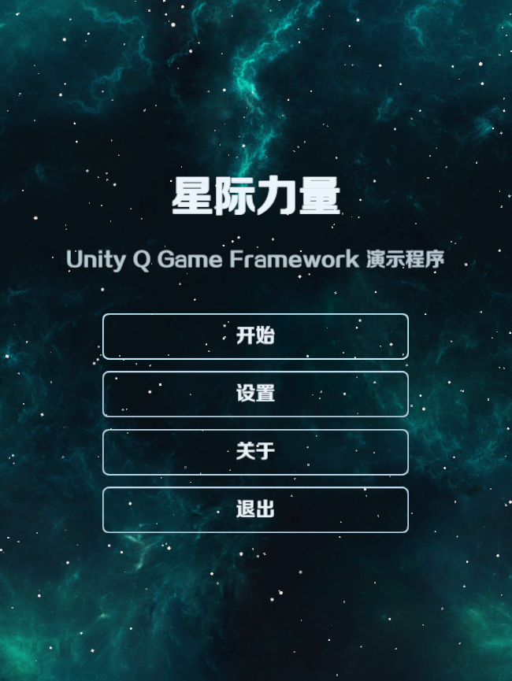
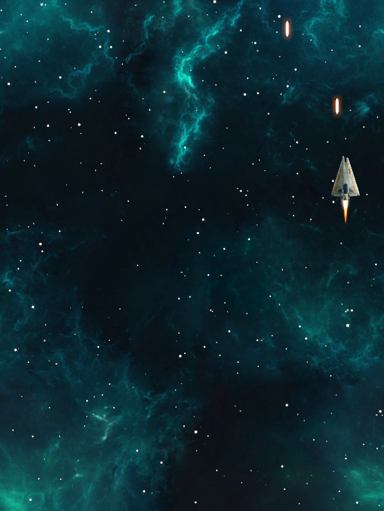

# StarForce

在 Package Manager 导入 `03 · StarForce`，打开 `StarForce Launcher.unity`。Game 视图选 3:4，点击“开始”后按住鼠标左键移动并开火。

| 菜单 | 战斗 |
| --- | --- |
|  |  |

## 启动

`ProcedureLaunch` 读取内置设置，恢复语言和音量。`ProcedurePreload` 加载 TOML 参数、Luban 表、语言字典和 UI 字体；全部完成后，把菜单场景 Id 传给 `ProcedureChangeScene`。

`ProcedureChangeScene` 用 Id 查询 `DRScene`，加载 `Menu.unity`，成功后进入 `ProcedureMenu`。点击开始时，菜单流程写入主场景 Id 和玩法类型，再经过同一个切场景流程进入 `Main.unity` 与 `ProcedureMain`。

## 战斗

```text
ProcedureMain
  → GameBase / SurvivalGame
  → EntityExtension 查询实体表并显示 MyAircraft
  → MyAircraft 更新移动与攻击
  → Weapon 创建 Bullet
  → 碰撞后归还 Bullet
```

表记录的 Id 标识实体类型，`entityId` 标识场上的单个实例。`SurvivalGame` 从小行星表的实际记录中随机选择类型，因此表 Id 可以不连续。`HPBarComponent` 使用 ObjectPool 复用血条，结束显示后归还。

## 表与资源

配置工作区位于示例的 `UnityQGameFramework/Config`：`Editor/LubanProfile.asset` 决定生成参数，`Source/Datas` 保存 Excel，`Generated` 和 `Data` 保存产物。在 `QGF > Settings` 选择 StarForce Profile，修改 Excel 后执行 `QGF > Generate Tables`。

Launcher 使用 Editor Resource Mode。构建 Windows Player 时运行 `QGF > Examples > 02 StarForce > Build Windows Player`；构建产物会包含所需 Package 资源。

源码位于仓库的 `Assets/Examples/02_StarForce`，UPM 样本位于 `Samples~/02_StarForce`。资源来源和许可见 [THIRD-PARTY.md](../Samples~/02_StarForce/THIRD-PARTY.md)。
