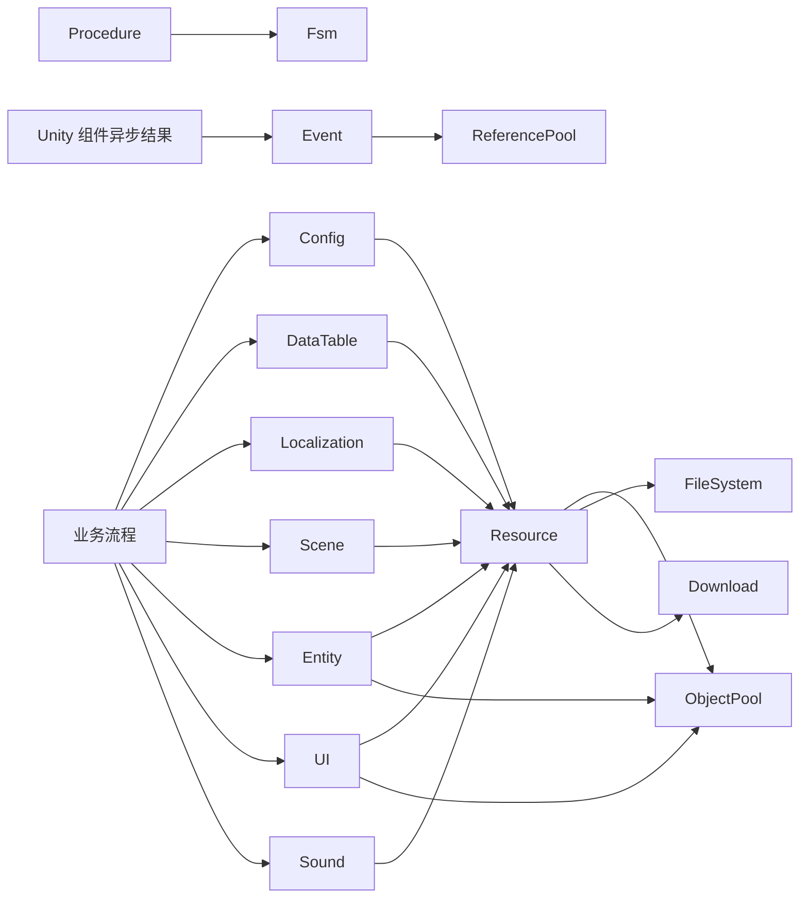

# 模块文档

先看[安装与第一个流程](../01-getting-started.md)和[运行机制](../00-runtime.md)，再按下表查模块接口。要运行场景，从 Package Manager 导入对应的[编号 Sample](../06-module-examples.md)。

| 想完成的工作 | 模块 | 与谁协作 |
| --- | --- | --- |
| 理解初始化、统一 Update、游戏时间与 Helper | [Base / Utility](base-utility.md) | 驱动全部 Core 模块，连接 Unity 平台能力 |
| 安排启动、预加载、菜单和战斗 | [Procedure](procedure.md) | 使用 Fsm，调用业务所需模块 |
| 给角色或业务流程建立独立状态机 | [Fsm](fsm.md) | 由 FsmManager 统一更新 |
| 发布和订阅业务消息 | [Event](event.md) | ReferencePool 回收事件参数 |
| 读取游戏参数 | [Config](config.md) | Resource、Event、Tomlyn |
| 制作和读取结构化 Excel 配置 | [DataTable](data-table.md)、[Luban 操作示例](../02-data-tables.md) | Luban 生成物、Catalog、Resource、Event |
| 保存音量、语言等本地偏好 | [Setting](setting.md) | 默认持久化文件与 JSON Helper |
| 共享内存中的临时值 | [DataNode / Variable](data-node.md) | 树形路径与引用池值包装 |
| 读取并格式化多语言文本 | [Localization](localization.md) | Resource、Event、Tomlyn；玩家选择可存 Setting |
| 加载资产并正确卸载 | [Resource](resource.md) | ObjectPool、FileSystem、Download、Helper |
| 从编辑器调试走向资源包与更新 | [资源构建](resource-build.md) | Collection、Analyze、Build、Pack、Sync、版本清单 |
| 加载和卸载游戏场景 | [Scene](scene.md) | 通过资源接口加载，Event 通知结果 |
| 显示、隐藏和附着角色 | [Entity](entity.md) | Resource、ObjectPool、Event、EntityLogic |
| 打开、关闭和分组界面 | [UI](ui.md) | Resource、ObjectPool、Event、UIFormLogic |
| 播放音效和音乐 | [Sound](sound.md) | Resource、声音组、播放代理 |
| 管理可反复使用的对象 | [ObjectPool](object-pool.md) | 包装 Target，控制借出、归还和淘汰 |
| 复用 C# 临时对象 | [ReferencePool](reference-pool.md) | 被事件、状态机、数据节点等内部使用 |
| 下载到磁盘文件 | [Download](download.md) | 任务队列、Agent、Event；被资源更新使用 |
| 请求 HTTP 接口 | [WebRequest](web-request.md) | Agent、Event；不经 Resource |
| 建立长连接并定义协议 | [Network](network.md) | Packet、通道 Helper、处理函数、Event |
| 管理容器中的逻辑文件 | [FileSystem](file-system.md) | 文件系统 Helper；被资源系统使用 |
| 在运行中观察模块与业务状态 | [Debugger](debugger.md) | 读取各模块状态，注册自定义窗口 |

## 模块边界

Core 通过接口与 Helper 工作，Unity 组件将结果转为 Runtime 事件。Config、Localization 和 DataTable 通过 Resource 读取数据；WebRequest 与 Network 分别处理 HTTP 和长连接。更多示例见[项目约定](../03-conventions.md)和[StarForce 导读](../05-starforce.md)。
