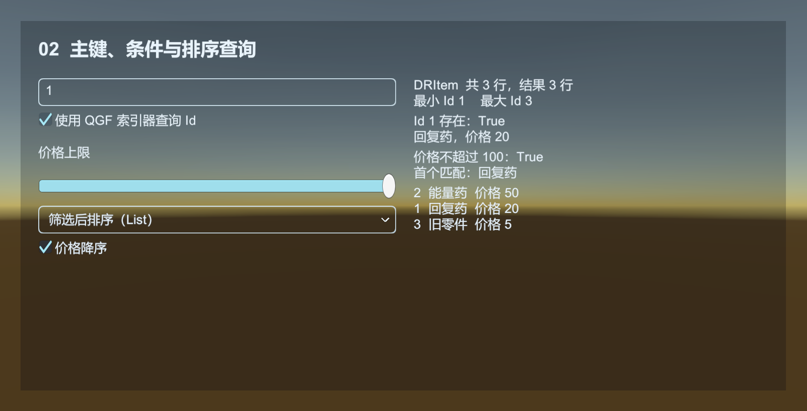

# DataTable：Luban 数据与游戏查询接口

Luban 从 Excel 生成 C# 类型和数据 bytes；DataTableComponent 加载 Catalog，再提供按 Id 和条件查询的统一接口。需要复合键或复杂索引时，直接使用 Luban 生成的 `Tables`。

[DataTable 示例](../../Samples~/11_DataTable/) 的四个场景共用 `Common/Config`。Excel schema、生成代码、bytes、Catalog 和 Profile 都在其中；Profile 只控制下次生成，不会改写已有产物。

| 示例 | 操作与观察 |
| --- | --- |
| 01_LoadCatalog | 比较 Inspector 与资源加载，取消、卸载、失败后重试，观察表数量和回调 |
| 02_QueryRows | 输入 Id、调整价格上限，比较数组与 List 的筛选、排序结果 |
| 03_NativeTable | 切换 Luban 的 GetOrDefault、Get、索引器，对比 QGF 返回的记录引用 |
| 04_TableRegistry | 用泛型或 Type 创建、查询、销毁具名表，登记已有的只读记录 |

04 的空表与内存记录用来说明登记接口，不会读取 Excel。`IDataTableManager` 按“行类型 + 名称”管理同一批视图，组件的 Count、Has/Get/Create/Destroy 和集合查询使用这份登记表。泛型入口在编译时确定行类型，Type 入口在运行时确定；省略名称使用默认名称。

`CreateDataTable` 只创建空的只读视图。Luban 负责反序列化真正的数据，生成的 Tables 再通过 `RegisterDataTables` 整批发布已构造的视图。这里没有旧 TXT 行解析流程。组件还负责 Catalog 资源引用、加载请求序号和 LubanTables；卸载整组 Luban 数据使用 `UnloadDataTables`，让这些状态一起清理。

源表在 `Common/Config/Source/Datas`，示例生成命名空间为 `UnityQGameFramework.Examples.TableData`。需要改表时，在 QGF Settings 中选择 `Common/Config/Editor/LubanProfile.asset`，执行 Generate Tables。四个场景引用同一个 Catalog，不需要分别生成。



## 四份内容各自在哪里起作用

| 内容 | 什么时候使用 | 负责什么 |
| --- | --- | --- |
| LubanProfile | 编辑器生成时 | 源表、输出目录、target、namespace 等参数 |
| Generated/*.cs | Unity 编译时 | 记录类型、索引、反序列化和跨表引用 |
| Data/*.bytes | 游戏加载时 | 本次导出的实际数值 |
| LubanDataTableCatalog | 游戏加载时 | 文件名到 TextAsset 的对应关系，以及结构 hash |

运行游戏不会读取 Excel，也不会执行 Luban 编译器。Profile 的全局选择决定下一次“生成哪一份”，不会替运行中的组件换掉 Catalog，更不会改写已编译的 C# 类型。

## 两种查询入口，共用同一批记录

默认工作区生成 UnityQGameFramework.Config.Tables、TbItem、DRItem。加载整组表后可以：

```csharp
// 方法内片段：需要 using UnityQGameFramework.Config;
var component = QGF.DataTable;

// QGF 通用视图：保留按 int Id、条件、排序查询的统一入口。
var items = component.GetDataTable<DRItem>();
DRItem item = items.GetDataRow(1); // 缺少该 Id 时返回 null。

// Luban 原生表集合：使用生成索引、DataList、DataMap 与跨表引用。
Tables tables = component.GetLubanTables<Tables>();
DRItem sameItem = tables.TbItem.GetOrDefault(1);
```

两个入口不是两次解析或复制整张表。生成的 Tables 构造函数先创建各 Tb 表、解析引用，再用 Tb 表中的 DataMap 发布 QGF DataTable 视图。

Luban 的 `Get(key)` 和索引器通常按生成代码的字典行为处理缺键，可能抛异常；想允许缺失，使用 GetOrDefault。QGF GetDataRow(id) 缺失返回 null。调用前应先确认整组表加载成功，不要把“表没加载”与“没有这个 Id”混为一谈。

## 一个完整的加载流程

先完成默认工作区的生成，将 Data/Catalog.asset 拖到 DataTableComponent 的 Luban Catalog。场景需要 Base、Resource、Event、DataTable 和 Procedure。

创建下面流程、加入流程列表并设为入口。Console 应列出默认 Item 表的数据；退出本流程会卸载本例加载的表。正式项目一般让公共配置存活到游戏关闭，不要在离开预加载流程时卸载。

```csharp
using UnityQGameFramework.Config;
using UnityQGameFramework.Core.Procedure;
using UnityQGameFramework.Runtime;
using ProcedureOwner = UnityQGameFramework.Core.Fsm.IFsm<UnityQGameFramework.Core.Procedure.IProcedureManager>;

namespace QgfDocs
{
    public sealed class DataTableGuideProcedure : ProcedureBase
    {
        private DataTableComponent component;
        private bool ownsTables;

        protected override void OnEnter(ProcedureOwner owner)
        {
            base.OnEnter(owner);
            component = QGF.DataTable;
            if (component.LubanTables != null)
            {
                Log.Warning("已有配置由其他系统持有，请在独立场景运行本例。");
                return;
            }
            component.LoadDataTables(loader => new Tables(loader), this);
            ownsTables = component.GetLubanTables<Tables>() != null;
            if (!ownsTables)
            {
                Log.Warning("加载失败，请检查 Catalog、结构版本与 Console。");
                return;
            }
            var items = component.GetDataTable<DRItem>();
            foreach (DRItem item in items) Log.Info("{0}: {1}", item.Id, item.Name);
        }

        protected override void OnLeave(ProcedureOwner owner, bool isShutdown)
        {
            if (ownsTables && !isShutdown) component.UnloadDataTables();
            ownsTables = false;
            base.OnLeave(owner, isShutdown);
        }
    }
}
```

Inspector 已引用 Catalog 的重载会同步反序列化和发布，但成功、失败通知仍通过 Event 队列发送。上面的示例直接检查加载结果；需要统一异步预加载计数时，应在调用前订阅 LoadDataTableSuccessEventArgs 与 LoadDataTableFailureEventArgs，并用 UserData 过滤。

另一重载接受 Catalog 资产路径：

```csharp
// 方法内片段：适用于经 Resource 加载 Catalog 的情况。
int requestId = component.LoadDataTables(
    "Assets/UnityQGameFramework/Config/Data/Catalog.asset",
    loader => new Tables(loader), this);
```

这个入口返回请求序号，完成时间取决于资源加载；必须等待结果事件。发行资源模式下，Catalog 及引用的 bytes 需要进入资源构建内容。CancelLoadDataTables 会使旧请求失效，不承诺中断底层 Resource I/O；过期回调会释放资源而不发布旧表。

01 的资源入口设置了两秒编辑器延迟，便于点击取消。取消后可以立即重试，新请求会获得更新的序号。卸载也会取消待完成请求；旧回调不会把已经卸载的表重新发布。

## 发布前会检查什么

Catalog 必须有结构 hash、非空数据项、有效 TextAsset 和不重复的文件名。工厂读取文件时，组件按文件名提供 ByteBuf；生成 Tables 后比较 SchemaHash，并检查读取器是否留下未消费的尾部数据，最后把全部视图一起登记到管理器。

这能发现结构、数据和 Catalog 混用等问题，不能证明数值符合所有玩法规则。跨表约束、主键与字段检查优先放进 Luban 定义；业务仍需验证“出生点必须存在”这类项目规则。

生成是覆盖管理的工作流，手写扩展不要放在 Generated。完整生成应一起提交 C#、bytes、Catalog、源表、Profile 与 .meta。若只提交其中一部分，另一台电脑即使编译通过，也可能在加载时报结构不一致。

## 常用接口与性能

| 需求 | 接口 |
| --- | --- |
| 按 Id 取记录 | `GetDataTable<T>().GetDataRow(id)` |
| 条件查找 / 多条筛选 | HasDataRow(predicate)、GetDataRow(predicate)、GetDataRows(predicate) |
| 排序或筛选后排序 | GetDataRows(comparison)、GetDataRows(predicate, comparison) |
| 遍历、数量、边界 | foreach、Count、MinIdDataRow、MaxIdDataRow |
| 避免重复创建结果数组 | 带 `List<T> results` 的重载，方法会清空并填充列表 |
| Luban 生成的索引和引用 | `GetLubanTables<Tables>()`，再访问 Tb 表 |
| 管理状态 | Count、IsLoading、LubanTables、`HasDataTable<T>` |
| 结束使用 | UnloadDataTables；不要在使用中逐个 DestroyDataTable |

Id 查询使用字典。Predicate 筛选是遍历，排序会收集后排序；高频大表查询应在 Luban schema 中设计索引，或初始化时建立业务索引。具体生成接口取决于表模式、主键与 Luban 定义，不保证每张表都有同名 Get 方法。

QGF 的 IDataRow 仍要求 int Id。生成器只为能适配这一视图的表发布 DataTable；非 int 主键、复杂索引等情况应使用 Luban 原生 Tables 入口，按实际生成代码查询。不要为迎合 GetDataRow 而把所有复合键强行压成一个整数。

配置记录是共享的只读定义；玩家当前 HP、剩余弹药、购买状态放到业务对象或存档中。不要通过强制转换 DataMap、修改记录中的可变集合来保存运行状态。

## 表的注册与销毁

表按“行类型 + 名称”区分。未命名表使用空名称，同一行类型可以有多张不同名称的表。HasDataTable、GetDataTable、CreateDataTable、DestroyDataTable 都有泛型与 Type 入口，GetAllDataTables 支持数组或 List。FullName 是包含完整行类型名的诊断标识。

CreateDataTable 创建空的只读视图。已有内存记录可传给 `new DataTable<T>(name, rows)`，再通过 Core 的 `IDataTableManager.RegisterDataTables` 登记，04 展示了这个入口。整批登记前会先检查重复类型与名称，失败时保留原有登记状态。

DestroyDataTable 结束该视图的使用，之后重新查询管理器，避免继续持有旧视图。Luban 整组数据使用 UnloadDataTables 卸载，保持原生集合与通用视图一致。

源码：[DataTableComponent](../../Runtime/Unity/DataTable/DataTableComponent.cs)、[LubanDataTableCatalog](../../Runtime/Unity/DataTable/LubanDataTableCatalog.cs)、[LubanTableSet](../../Runtime/Unity/DataTable/LubanTableSet.cs)、[DataTable 视图](../../Runtime/Core/DataTable/DataTableManager.DataTable.cs)。
