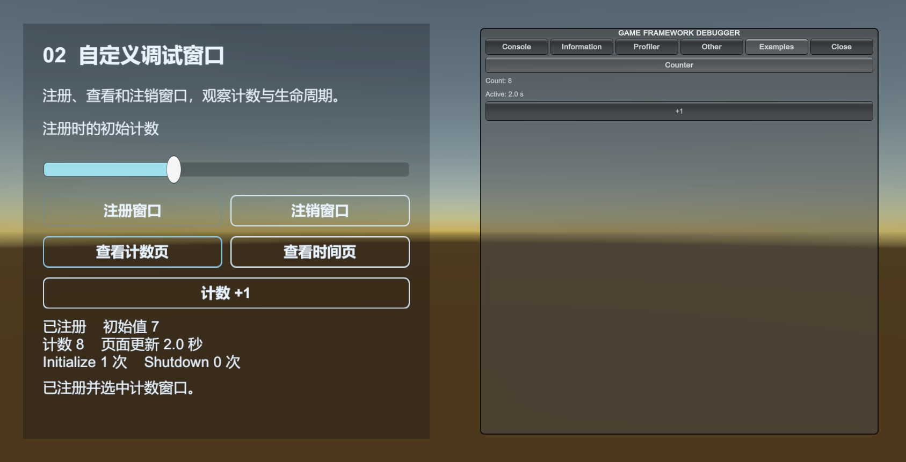

# Debugger：查看运行状态

Debugger 用 IMGUI 查看环境、时间、日志和模块状态。StarForce 左上角的 DEBUGGER 按钮可打开窗口。

[Debugger 示例](../../Samples~/21_Debugger/) 分别查看运行状态、接入自定义窗口和读取最近日志：

| 目录 | 操作 |
| --- | --- |
| 01_Inspect | 开关入口、展开窗口、选择页面、缩放与重置布局 |
| 02_CustomWindow | 注册计数窗口，传入初始值，对比按钮选页与顶部页签回调，注销后重新注册 |
| 03_RecentLogs | 用 QGF Log 发消息，查询全部或最近几条日志 |



## 注册自己的窗口

将下面脚本挂在 GameObject 上，场景需包含 Base 和 Debugger 组件。运行后选择 Guide/Runtime，点击 Ping 增加计数。

```csharp
using UnityEngine;
using UnityQGameFramework.Core.Debugger;
using UnityQGameFramework.Runtime;

namespace QgfDocs
{
    public sealed class RuntimeGuideWindow : IDebuggerWindow
    {
        private int count;
        public void Initialize(params object[] args) => count = 0;
        public void Shutdown() { }
        public void OnEnter() { }
        public void OnLeave() { }
        public void OnUpdate(float elapseSeconds, float realElapseSeconds) { }

        public void OnDraw()
        {
            GUILayout.Label("Ping 次数：" + count);
            if (GUILayout.Button("Ping")) count++;
        }
    }

    public sealed class DebugPanelExample : MonoBehaviour
    {
        private DebuggerComponent debugger;
        private string path;

        private void Start()
        {
            debugger = QGF.Debugger;
            path = "Guide/Runtime " + GetInstanceID();
            debugger.RegisterDebuggerWindow(path, new RuntimeGuideWindow());
        }

        private void OnDestroy()
        {
            if (debugger != null && path != null) debugger.UnregisterDebuggerWindow(path);
        }
    }
}
```

路径中的 `/` 创建窗口组。注册时的参数传给 Initialize，注销时调用 Shutdown。窗口由注册它的业务负责注销。

OnUpdate 更新当前选中页面的数据。OnDraw 负责绘制控件，按钮操作放在对应分支中。

02_CustomWindow 显示六个接口方法的效果：Initialize 接收初始计数，Shutdown 记录注销次数，OnUpdate 累计页面时间，OnDraw 显示计数按钮，OnEnter/OnLeave 记录顶部页签的进入和离开。

当前实现中，`SelectDebuggerWindow(path)` 只改变选中项。点击调试器顶部页签切换时，才会对原页面调用 OnLeave、对新页面调用 OnEnter。可先用左侧按钮选页，再点击右侧调试器的页签，比较回调次数。注销直接调用 Shutdown，因此资源和订阅的最终清理应放在 Shutdown。

窗口组实现 `IDebuggerWindowGroup`，同时也是一个 `IDebuggerWindow`。DebuggerWindowRoot 是根组；路径中的每一段对应组或页面。业务通常通过组件注册和选择完整路径，组接口用于读取名称列表、当前索引和选中页面。

## 布局与日志

| API | 用途 |
| --- | --- |
| ActiveWindow | 开关调试入口 |
| ShowFullWindow | 在完整窗口和图标之间切换 |
| WindowRect / IconRect | 设置窗口和图标矩形 |
| WindowScale | 缩放 IMGUI，矩形坐标按缩放前尺寸计算 |
| ResetLayout() | 恢复默认矩形和缩放 |
| GetDebuggerWindow(path) | 取得已注册窗口，缺失时返回 null |
| SelectDebuggerWindow(path) | 选中路径，未找到时返回 false |
| GetRecentLogs(results) | 将已记录的日志填入 List |
| GetRecentLogs(results, count) | 取得末尾 count 条，保留记录顺序 |

日志查询会清空并重新填入 List。LogNode 由调试器持有；需要长期保存时复制文本、时间和类型。03_RecentLogs 每次刷新查询结果，界面显示当前结果集。

Log.Info、Log.Warning 受编译宏控制。新项目没有启用时，在 `QGF > Logging > Info` 开启信息及以上级别，再运行示例；Sample 导入不会修改项目宏。关闭某一级别会移除对应调用，因此按钮仍可点击，但不会产生那一级别的日志。

宽屏时操作区和调试窗口左右排列；竖屏时上下排列，操作区可滚动。缩放受到可用宽度限制，避免顶部页签把窗口撑出屏幕。

01_Inspect 退出时通过 Base.GameSpeed 恢复原速度，同时更新组件记录和 Unity 时间。暂停时只恢复 Time.timeScale，会让 Base.IsGamePaused 仍保持为 true。

示例共用 Common 中的 Setting Helper，将调试器偏好保存在 `persistentDataPath/QgfExamples/Debugger.dat`。

源码：[DebuggerComponent](../../Runtime/Unity/Debugger/DebuggerComponent.cs)、[IDebuggerWindow](../../Runtime/Core/Debugger/IDebuggerWindow.cs)。
