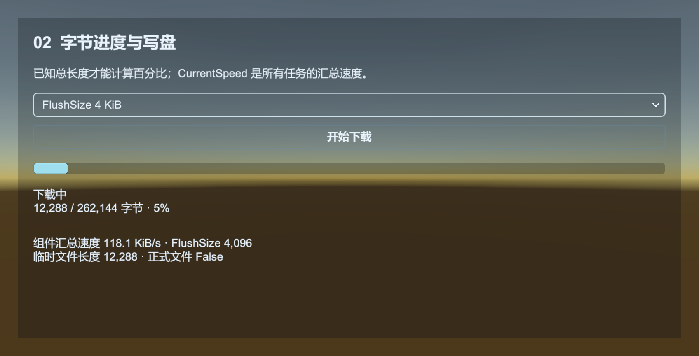

# Download：下载文件到磁盘

Download 把 URI 的内容写入磁盘文件。Resource 更新也用它下载资源；普通下载不会自动导入 AssetDatabase，也不会生成 AssetBundle。

[Download 示例](../../Samples~/19_Download/) 自带本机 HTTP 服务，可操作文件保存、进度、取消续传、队列和失败处理。下图按已知文件长度计算百分比。



## 下载测试文件

沿用 [WebRequest 示例](web-request.md) 的本地服务器，在服务器目录放入 `hello.txt`。场景中需要 Base、Event、Download，并在 Download Inspector 中为默认 Agent Helper 分配至少一个代理。

创建 `Assets/MyGame/Scripts/DownloadExample.cs`，挂到 GameObject 上。运行后右键选择 Download file。下载完成会在 Application.persistentDataPath 下生成 GuideDownloads/hello.txt。

```csharp
using System.IO;
using UnityEngine;
using UnityQGameFramework.Core.Event;
using UnityQGameFramework.Runtime;

namespace QgfDocs
{
    public sealed class DownloadExample : MonoBehaviour
    {
        private EventComponent events;
        private DownloadComponent download;
        private int serialId;

        private void Start()
        {
            events = QGF.Event;
            download = QGF.Download;
            events.Subscribe(DownloadSuccessEventArgs.EventId, OnSuccess);
            events.Subscribe(DownloadFailureEventArgs.EventId, OnFailure);
            events.Subscribe(DownloadUpdateEventArgs.EventId, OnProgress);
        }

        [ContextMenu("Download file")]
        public void DownloadFile()
        {
            if (download == null || serialId != 0) return;
            string path = Path.Combine(Application.persistentDataPath, "GuideDownloads", "hello.txt");
            serialId = download.AddDownload(path, "http://127.0.0.1:8000/hello.txt",
                "Guide.File", 0, this);
        }

        private void OnSuccess(object sender, GameEventArgs args)
        {
            var e = (DownloadSuccessEventArgs)args;
            if (!ReferenceEquals(e.UserData, this) || e.SerialId != serialId) return;
            serialId = 0;
            Log.Info("下载完成：{0}，{1} 字节", e.DownloadPath, e.CurrentLength);
        }

        private void OnProgress(object sender, GameEventArgs args)
        {
            var e = (DownloadUpdateEventArgs)args;
            if (!ReferenceEquals(e.UserData, this) || e.SerialId != serialId) return;
            // 这是已下载字节数；小文件可能在两次界面刷新之间已经完成。
            Log.Info("已下载 {0} 字节", e.CurrentLength);
        }

        private void OnFailure(object sender, GameEventArgs args)
        {
            var e = (DownloadFailureEventArgs)args;
            if (!ReferenceEquals(e.UserData, this) || e.SerialId != serialId) return;
            serialId = 0;
            Log.Warning(e.ErrorMessage);
        }

        private void OnDestroy()
        {
            if (download != null && serialId != 0) download.RemoveDownload(serialId);
            if (events == null) return;
            if (events.Check(DownloadSuccessEventArgs.EventId, OnSuccess))
                events.Unsubscribe(DownloadSuccessEventArgs.EventId, OnSuccess);
            if (events.Check(DownloadFailureEventArgs.EventId, OnFailure))
                events.Unsubscribe(DownloadFailureEventArgs.EventId, OnFailure);
            if (events.Check(DownloadUpdateEventArgs.EventId, OnProgress))
                events.Unsubscribe(DownloadUpdateEventArgs.EventId, OnProgress);
        }
    }
}
```

文件下载成功只证明传输完成。要安装远程配置或补丁，还需要验证预期长度、哈希、签名及业务版本，再决定是否使用。资源补丁优先使用 Resource 的版本与资源校验流程。

## 文件是怎样写入的

Core DownloadAgent 先写 `目标路径.download`，按 FlushSize 刷新文件流；完成后将临时文件移动为目标文件。已有最终文件会在替换阶段被删除，因此下载路径必须由本业务明确拥有，不能指向玩家存档或别的模块的文件。

已有临时文件时，框架会从已保存长度请求 Range。默认 UnityWebRequestDownloadAgentHelper 要求服务器返回 206 且 Content-Range 起点匹配；服务器忽略 Range 或起点错误会进入失败事件，不会把完整响应追加进旧临时文件。HTTP 错误正文也不会写入文件；416 则清理不可用的临时文件。修改下载内容后复用同一临时路径，可能把不同版本混在一起，应使用带版本的文件名或在确认拥有该临时文件后清理。

`CurrentLength` 是累计字节数，包含续传前已有的部分。业务提供文件总长度后，可以计算百分比。`CurrentSpeed` 是组件内所有任务的汇总速度。

## 查询、暂停和取消

| API / 属性 | 作用 |
| --- | --- |
| AddDownload(path, uri, tag, priority, userData) | 添加任务，返回 serialId |
| RemoveDownload(serialId) | 移除本次任务 |
| RemoveDownloads(tag) | 按业务标签批量移除 |
| Paused | 暂停任务池的调度，不能当成某个 HTTP 流的精确暂停按钮 |
| TotalAgentCount / WorkingAgentCount / WaitingTaskCount | 查看并发与排队 |
| Timeout / FlushSize | 连续无数据超时与文件流刷新批量大小 |
| GetDownloadInfo / GetAllDownloadInfos | 查询任务状态 |

先订阅事件，再添加任务；成功、失败都匹配 serialId 和 UserData。不要把移除任务当作一定会产生一个业务失败事件，取消的拥有者应自行结束加载状态。普通业务也不要 RemoveAllDownloads，否则可能影响正在执行的框架资源更新。

源码：[DownloadComponent](../../Runtime/Unity/Download/DownloadComponent.cs)、[DownloadManager](../../Runtime/Core/Download/DownloadManager.cs)、[DownloadAgent](../../Runtime/Core/Download/DownloadManager.DownloadAgent.cs)。

取消会关闭连接与文件流，并保留临时文件；再次添加同一路径得到新任务序号，尝试续传。取消处应主动结束自己的业务等待。已经排入 Event 队列的结果不会被撤回，回调仍应匹配当前任务序号。

Timeout 在任务入队时保存，每次收到数据后重新计时。FlushSize 也按入队时的值执行；`FileInfo.Length` 显示文件逻辑长度，不表示物理介质已完成写入。
