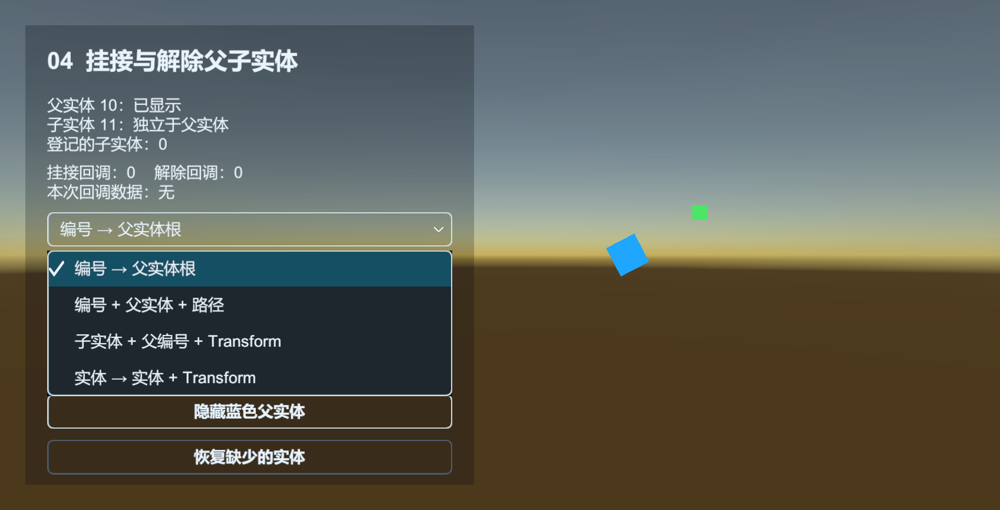

# Entity：显示一架飞机或一个敌人

Entity 管理需要运行时创建、隐藏、附着或复用的游戏对象。它不是 Unity ECS；场景里固定不动的物体不必交给 Entity 管理。

显示实体时传入 entityId、预制体路径、EntityLogic 类型和分组。资源就绪后才会创建实例；隐藏时通常将实例送回对象池。

## 显示一个旋转 Cube

先创建 `Assets/MyGame/Prefabs/Cube.prefab`。预制体只需要普通 Cube，不要给它加全局的 EntityComponent，也不需要预先挂下面的逻辑组件，框架会按类型添加。

创建 `RotatingCubeLogic.cs`：

```csharp
using UnityEngine;
using UnityQGameFramework.Runtime;

namespace QgfDocs
{
    public sealed class RotatingCubeLogic : EntityLogic
    {
        protected override void OnShow(object userData)
        {
            base.OnShow(userData);
            CachedTransform.position = userData is Vector3 position ? position : Vector3.zero;
            CachedTransform.rotation = Quaternion.identity;
        }

        protected override void OnUpdate(float elapseSeconds, float realElapseSeconds)
        {
            base.OnUpdate(elapseSeconds, realElapseSeconds);
            CachedTransform.Rotate(Vector3.up, 45f * elapseSeconds);
        }
    }
}
```

再创建 `EntityGuideProcedure.cs`，设为入口流程，Base 开启编辑器资源模式：

```csharp
using UnityEngine;
using UnityQGameFramework.Core.Fsm;
using UnityQGameFramework.Core.Procedure;
using UnityQGameFramework.Runtime;

namespace QgfDocs
{
    public sealed class EntityGuideProcedure : ProcedureBase
    {
        private const int CubeId = 10001;
        private EntityComponent entities;

        protected override void OnEnter(IFsm<IProcedureManager> owner)
        {
            base.OnEnter(owner);
            entities = QGF.Entity;
            if (!entities.HasEntityGroup("Guide"))
                entities.AddEntityGroup("Guide", 30f, 8, 60f, 0);
            entities.ShowEntity<RotatingCubeLogic>(CubeId,
                "Assets/MyGame/Prefabs/Cube.prefab", "Guide", Vector3.zero);
        }

        protected override void OnLeave(IFsm<IProcedureManager> owner, bool isShutdown)
        {
            if (entities.HasEntity(CubeId) || entities.IsLoadingEntity(CubeId))
                entities.HideEntity(CubeId);
            base.OnLeave(owner, isShutdown);
        }
    }
}
```

Hierarchy 中应出现带 Entity 和 RotatingCubeLogic 的实例，并持续旋转。如果场景摄像机没有朝向原点，先调整摄像机再检查 Game 画面。

## 分清三种编号

[Entity 示例](../../Samples~/01_Modules/13_Entity/)使用旋转的蓝色 Cube，演示显示/隐藏和复用两个核心流程。复用场景会在画面里对比复用前后的实例 ID，并显示等待进度：



- 实体编号：这一次显示的对象身份，同一时刻不能重复；业务自行分配。
- 配置表编号：例如某种飞机的设计配置，多个实例可以使用同一条配置。
- 资源路径：决定加载哪个预制体，同一资源可以产生许多实体。

StarForce 的 EntityExtension 把后两者连接起来，先查配置再构造资源路径。那是示例的业务封装，不是 EntityComponent 必须依赖某张表。

## 查询全部还是查询某个组

03 的上半部分通过 `QGF.Entity` 查询全部已显示实体、实体组和待加载编号。下半部分先调用 `GetEntityGroup("Left")` 或 `GetEntityGroup("Right")`，再查询该组内的实体：

- `HasEntity(id / asset)`：按编号或资源路径判断是否存在。
- `GetEntity(id / asset)`：按编号取得实例，或取得该资源的首个实例；没有时返回 null。
- `GetAllEntities()`、`GetEntities(asset)`：返回全部或同资源实体的数组。
- 对应的 List 重载：先清空传入 List，再写入结果，可复用容器。

组对象实现 Core 的 `IEntityGroup`，因此组查询的元素类型是 `IEntity`；Unity 组件的全局查询返回 Runtime 的 `Entity`。编号在管理器内唯一，但 `Left.GetEntity(2)` 仍找不到 Right 中的实体。隐藏 Left 的 Cube 后再查询，可以对照空组与仍有实体的全局查询。

查询结果显示的是按下按钮时的快照。显示请求仍在加载时，组查询不包含它；待加载编号由组件查询。`GetEntity(asset)` 只承诺返回首个匹配项，需要固定实例时使用编号。

## 实例的生命周期

| 回调 | 放什么 |
| --- | --- |
| OnInit | 首次创建该逻辑时缓存组件，调用 base 初始化 CachedTransform 与 Entity |
| OnShow | 每次显示重设位置、血量、目标、计时和订阅 |
| OnUpdate | 显示期间的业务更新，区分逻辑时间与真实时间 |
| OnHide | 取消本次订阅、清除目标与自己拥有的数据，调用 base 隐藏 |
| OnRecycle | 回收阶段的补充清理，不把它当成每次显示初始化 |
| OnAttachTo / OnDetachFrom | 处理被附着或分离的对象 |

同资源实例可能换一次实体编号后再次显示。不要在 OnInit 中只设置一次血量，也不要长期缓存某个实体编号对应的 Logic 而不检查它是否还 Available。

02 同时显示 OnInit、OnShow、OnHide、OnRecycle 计数：立即复用时 Init 仍为 1，其余计数随显示、隐藏和回池增加；过期释放后则出现新的实例编号，计数重新开始。

## 加载完成以前能做什么

ShowEntity 不是同步创建。要在显示成功后取实体，订阅 `ShowEntitySuccessEventArgs` 并检查 Entity.Id、UserData；失败订阅 `ShowEntityFailureEventArgs`。不要紧接着 ShowEntity 就假定 GetEntity 已有返回值。

HideEntity 可以处理仍在加载中的显示请求，后续结果会按管理器的取消记录处理。01、03 的场景将资源延迟设为两秒，便于观察取消和待加载编号；HideAllLoadingEntities 作用于该管理器的所有待显示实体。四个控制脚本退出时只隐藏自己创建的编号，同时取消自己的待显示请求，其他实体继续保留。

## 附着和对象池

AttachEntity 将一个受管理实体附着到另一个实体或其某个 Transform，用于武器、推进器等。DetachEntity 解除关系。需要读子节点时使用实际 Transform 路径，不把它当成资源路径。

04 将绿色子实体挂到持续旋转的蓝色父实体上。下拉框比较四种编号/实例组合、根节点/路径/Transform、是否传入上下文；根节点传字符串上下文时要写成 `(object)"挂接数据"`，否则会选中路径重载。解除后子实体保留当前世界位置；挂接时隐藏父实体会递归隐藏子实体，解除后则互不影响。

“查询父子关系”同时演示 GetParentEntity、GetChildEntity、GetChildEntities 的编号与实例入口，以及子实体集合的数组和 List 重载。结果是按下按钮时的快照；在挂接前、挂接后、解除后各查询一次，可以对照登记关系的变化。

每个实体组有自己的实例池配置：容量、自动释放间隔、过期时间和优先级。这些控制缓存维护，不是“最多只能显示多少个敌人”的硬性玩法上限。资源实际释放经由 EntityHelper 再归还 Resource。

Entity 不会自动回收 userData。若使用自定义 IReference 数据，应由业务约定接管与释放；当前 StarForce 的 EntityData 是普通 C# 对象。

源码：[EntityComponent](../../Runtime/Unity/Entity/EntityComponent.cs)、[EntityLogic](../../Runtime/Unity/Entity/EntityLogic.cs)、[实例包装](../../Runtime/Unity/Entity/Entity.cs)、[EntityManager](../../Runtime/Core/Entity/EntityManager.cs)。
