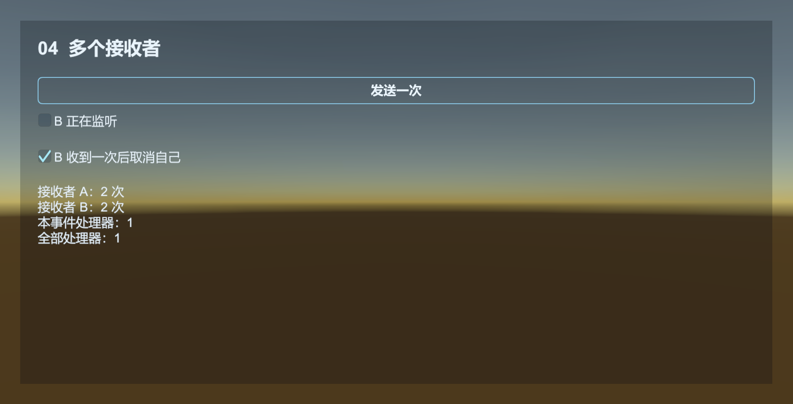

# Event：让背包变化通知界面

背包增加金币后，界面要更新数字，成就系统也可能要记录累计值。背包只发送一次事件，仍在工作的监听者各自处理。

业务通过 EventComponent 订阅和派发。Core 的 EventManager 用整数 EventId 分发；事件参数由 ReferencePool 复用。

## 先运行一个完整例子

在已放入框架预制体的场景中，创建 `RewardEventExample.cs`，挂到空物体上。这个例子只使用已经在 Awake 中完成初始化的 Event 模块。

```csharp
using UnityEngine;
using UnityQGameFramework.Core;
using UnityQGameFramework.Core.Event;
using UnityQGameFramework.Runtime;

namespace QgfDocs
{
    public sealed class GoldAddedEventArgs : GameEventArgs
    {
        public static readonly int EventId = typeof(GoldAddedEventArgs).GetHashCode();
        public override int Id => EventId;
        public int Amount { get; private set; }

        public static GoldAddedEventArgs Create(int amount)
        {
            var args = ReferencePool.Acquire<GoldAddedEventArgs>();
            args.Amount = amount;
            return args;
        }

        public override void Clear() => Amount = 0;
    }

    public sealed class RewardEventExample : MonoBehaviour
    {
        private EventComponent events;

        private void Start()
        {
            events = QGF.Event;
            events.Subscribe(GoldAddedEventArgs.EventId, OnGoldAdded);
            events.Fire(this, GoldAddedEventArgs.Create(20));
        }

        private void OnGoldAdded(object sender, GameEventArgs e)
        {
            int amount = ((GoldAddedEventArgs)e).Amount;
            Log.Info("收到金币：" + amount);
        }

        private void OnDestroy()
        {
            if (events != null && events.Check(GoldAddedEventArgs.EventId, OnGoldAdded))
                events.Unsubscribe(GoldAddedEventArgs.EventId, OnGoldAdded);
        }
    }
}
```

Console 会输出 `收到金币：20`。发送和接收可以拆到不同脚本，发送方不需要知道接收方是什么类型。

## Fire 与 FireNow

`Fire(sender, args)` 的 sender 是发送者对象；事件编号来自 args.Id。接收函数用 sender 判断来源，用 args 读取本次数据。01 示例会显示最近一次发送者是否为当前示例对象。

运行 [02 派发顺序](../../Samples~/04_Event/02_DispatchOrder/)。同一个接收函数分别处理立即消息和排队消息，界面显示回调与发送代码的执行次序。

| 方法    | 执行时机                        | 线程约定                                                   |
| ------- | ------------------------------- | ---------------------------------------------------------- |
| Fire    | 参数入队，由 Event 模块轮询分发 | 入队有锁，可由工作线程提交；处理函数仍在驱动模块的线程执行 |
| FireNow | 调用点立即执行处理函数          | 不提供线程安全；Unity 项目从主线程调用                     |

Event.Update 循环处理队列，回调中再次 Fire 的事件也可能在同次轮询中派发。需要控制先后顺序时，在业务状态中安排步骤。

FireNow 返回前，接收函数已执行；后续代码需按界面和状态的最新值继续。

## 参数是谁释放的

正常派发结束后，事件池自动执行 `ReferencePool.Release(e)`。发送者和接收者都把参数的释放交给事件池。

跨回调保留内容时，复制 Amount、Id 等值；内容是引用对象时，明确由谁维护它。`Clear()` 清空参数字段和外部引用，供下次借用。

事件处理函数抛出的异常会中断后续调用。捕获可预期的业务失败并记录必要信息，让其他接收函数继续处理。

## 实际项目的订阅位置

Config、Resource、Entity 等模块先在 Core 发出自己的 C# 事件，再由 Unity 组件转成 Runtime 事件参数。Unity 示例订阅 `QGF.Event`，因此回调收到的是 `GameEventArgs`；纯 C# 宿主使用管理器接口上的事件，两者的参数类型不同。

部分组件在 Inspector 中控制是否转发事件，订阅前先确认对应开关。

| 组件 | 事件开关与默认值 |
| --- | --- |
| Config / Localization | 进度、依赖通知默认关闭；成功和失败正常转发 |
| Entity / Sound | 加载进度、依赖通知默认关闭；成功、失败正常转发，Entity 另有隐藏完成通知 |
| UI | 成功、失败、关闭完成默认开启；进度、依赖默认关闭，五种通知都能单独关闭 |
| Scene | 加载进度、依赖通知默认开启，可在 Inspector 关闭 |
| Download / WebRequest / Network / Resource | 管理器事件由组件转发，没有上述逐项开关 |

关闭 UI 成功通知不会阻止窗口打开，只会停止向 QGF.Event 发送这项通知。代码若在成功事件里继续下一步，应保留对应开关。

Luban DataTable 的加载通知由 Unity 组件在加载表集时发出；Core 管理器负责表注册和查询，不使用旧的数据提供器读表流程。

- Procedure：OnEnter 订阅，OnLeave 取消。
- UIFormLogic：OnOpen 订阅，OnClose 取消。
- EntityLogic：OnShow 订阅，OnHide 取消。
- 普通 MonoBehaviour：根据“是否禁用时仍要接收”选择 OnEnable/OnDisable 或 Start/OnDestroy，并保持对称。

默认 EventManager 允许没有监听者，也允许同一 Id 注册多个监听者；同一处理函数不可重复注册。`Unsubscribe` 只接受当前已注册的处理函数，找不到订阅时会抛异常。

`Check(id, handler)` 检查指定订阅，`Count(id)` 统计该事件的接收函数。`SetDefaultHandler` 设置无人订阅时的处理函数；03 示例可开关默认处理，04 示例对比多个接收者以及派发中取消订阅。



示例的 Type.GetHashCode 只用于同一进程内的事件标识，不用于存档、跨进程协议或固定网络消息编号。

源码：[EventComponent](../../Runtime/Unity/Event/EventComponent.cs)、[EventManager](../../Runtime/Core/Event/EventManager.cs)、[事件池](../../Runtime/Core/Base/EventPool/EventPool.cs)。
