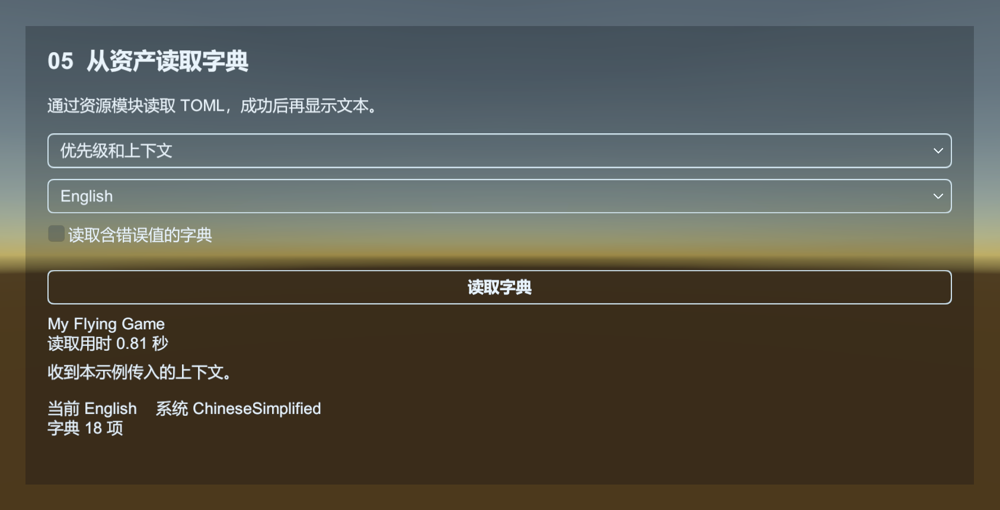

# Localization：用 TOML 管理多语言文本

Localization 用键读取当前语言的文本，例如 `Game.Name` 和 `Menu.Start`。界面保存键名，不直接写各语言的文案；读取字符串时还可以传格式化参数。它与 Config 分开管理。

[Localization 示例](../../Samples~/01_Modules/10_Localization/) 共用 `Common/Dictionary.toml`，演示读取和切换语言。

| 示例 | 操作与观察 |
| --- | --- |
| 01_ReadText | 查询文本、缺键标记，切换 1 至 16 个参数的格式化入口 |
| 02_SwitchLanguage | 对比只设置 Language 与重新解析字典后的文本 |
| 03_Parse | 比较六种 ParseData 入口，查询原始文本、移除键、预留与释放缓冲 |
| 04_RuntimeKeys | 添加、移除运行时键，比较原始占位符与格式化结果 |
| 05_Load | 比较四种 ReadData 入口，观察异步成功、解析失败、上下文与重试 |



默认读取器使用 Tomlyn。下面是标准 TOML，语言名与框架的 Language 枚举一致：

```toml
[ChineseSimplified.Game]
Name = "我的游戏"

[ChineseSimplified.Reward]
Gold = "获得 {0} 金币"

[English.Game]
Name = "My Game"

[English.Reward]
Gold = "Received {0} gold"
```

当前语言是 ChineseSimplified 时，解析器只读取这一语言的子树，并将嵌套键展开为 Game.Name、Reward.Gold。`[Korean.Game]` 表示 Korean 下的 Game；`[Korean]` 下的 `"Game.Name"` 则是一个含句点的字面键。两种写法都能映射为同一查询键，因此同一语言中不能混用而造成重复。

## 先验证查询，再接资产加载

场景中保留 Base、Localization、Resource 和 Event。把下面脚本加入自己的流程列表，设为入口流程，运行后应依次看到“我的游戏”“获得 25 金币”“My Game”。

```csharp
using UnityQGameFramework.Core.Localization;
using UnityQGameFramework.Core.Procedure;
using UnityQGameFramework.Runtime;
using ProcedureOwner = UnityQGameFramework.Core.Fsm.IFsm<UnityQGameFramework.Core.Procedure.IProcedureManager>;

namespace QgfDocs
{
    public sealed class LocalizationGuideProcedure : ProcedureBase
    {
        private const string DictionaryText =
            "[ChineseSimplified.Game]\nName = \"我的游戏\"\n" +
            "[ChineseSimplified.Reward]\nGold = \"获得 {0} 金币\"\n" +
            "[English.Game]\nName = \"My Game\"\n";

        protected override void OnEnter(ProcedureOwner owner)
        {
            base.OnEnter(owner);
            var localization = QGF.Localization;
            localization.Language = Language.ChineseSimplified;
            if (!localization.ParseData(DictionaryText))
            {
                Log.Error("语言字典解析失败。");
                return;
            }
            Log.Info(localization.GetString("Game.Name"));
            Log.Info(localization.GetString("Reward.Gold", 25));

            localization.RemoveAllRawStrings();
            localization.Language = Language.English;
            if (localization.ParseData(DictionaryText))
                Log.Info(localization.GetString("Game.Name"));
        }

        protected override void OnLeave(ProcedureOwner owner, bool isShutdown)
        {
            QGF.Localization.RemoveAllRawStrings();
            base.OnLeave(owner, isShutdown);
        }
    }
}
```

该示例清空自己的独立字典。游戏中按业务范围管理键，清理公共字典会影响所有使用它的界面。

## 从资产读取

将 TOML 保存为 `Assets/MyGame/Localization/Default.toml`，加入 YooAsset Collector 的收集规则，并设置 `EnableAddressable` 与 `AddressByFileName`。在预加载流程里调用：

```csharp
// 方法内片段：先订阅成功和失败事件，再发起读取。
var localization = QGF.Localization;
localization.Language = Language.ChineseSimplified;
localization.ReadData("Default", this);
```

ReadData 经 Resource 加载 TextAsset，再由 DefaultLocalizationHelper 调用 TOML 解析器，完成后释放资产引用。加载是异步的，不能紧接下一行就 GetString。

ParseData 则在当前调用中完成，直接返回解析结果，不发送 LoadDictionary 事件。字符串入口解析 TOML；字节入口按 UTF-8 解码；片段入口只读取指定范围。userData 会交给 Helper，默认 Helper 不使用它。

| Runtime 事件 | 用途 |
| --- | --- |
| LoadDictionarySuccessEventArgs | 该份字典解析并加入成功，可以创建依赖它的 UI |
| LoadDictionaryFailureEventArgs | 读取或解析失败，输出 ErrorMessage 并决定重试或回退 |
| LoadDictionaryUpdateEventArgs | 加载进度 |
| LoadDictionaryDependencyAssetEventArgs | 依赖资产进度 |

事件订阅、UserData 过滤和退出取消订阅的写法与 [Config](config.md) 的完整流程相同，替换成上表的字典事件类型。不要同时解析并读取同一份字典，否则会因重复键而失败。

## 切换语言需要完成一整次更新

仅修改 Language 属性不会重新读文件，也不会自动刷新已经显示的 Text。切换时先准备好目标语言；清理旧字典，设置 Language，重新 ReadData；等待成功后再通知各界面重新取文字。失败时应恢复旧语言及其字典，或显示项目约定的回退界面。

Language 与 SystemLanguage 也不同。SystemLanguage 来自 Unity 系统语言映射，可用来选择首次启动的默认语言；玩家的选择应保存到 [Setting](setting.md)，下次启动再恢复。

`GetString` 从当前字典查询。缺键返回 `<NoKey>键名`，格式化失败返回 `<Error>` 诊断文本，可据此检查翻译和参数。切换语言时重新加载对应字典。

解析器拒绝非字符串叶子、扁平化后重复的键，以及与当前已加载字典重复的键；加入失败会回滚本次新增的键。多个文件可以组成一套语言，但必须约定各自的键前缀。

DictionaryCount 是当前字典的文本条目数。GetRawString 保留 `{0}` 等占位符，缺键返回 null；GetString 根据传入参数格式化。HasRawString、RemoveRawString、RemoveAllRawStrings 管理当前内存中的键。

运行时添加由 `FrameworkEntry.GetModule<ILocalizationManager>().AddRawString(key, value)` 提供；它和组件访问同一字典，重复键返回 false 并保留旧值。04 示例先移除再添加来替换文本，修改不会写回 TOML。

组件的查询、格式化、语言属性和键管理转发给同一个 `ILocalizationManager`。`SetResourceManager`、`SetDataProviderHelper` 与 `SetLocalizationHelper` 由组件在启动时完成，分别连接资源读取、数据解析和系统语言等平台能力。使用 QGF.Localization 时不必再手动连接一次。

`EnsureCachedBytesSize` 和 `FreeCachedBytes` 管理本地化数据提供器共用的读取缓冲，不添加或移除翻译，也不切换语言。03_Parse 可以分别观察缓冲大小与字典条目数；它们属于不同状态。

源码：[LocalizationManager](../../Runtime/Core/Localization/LocalizationManager.cs)、[TomlLocalizationParser](../../Runtime/Core/Localization/TomlLocalizationParser.cs)、[DefaultLocalizationHelper](../../Runtime/Unity/Localization/DefaultLocalizationHelper.cs)。

02 中关闭“同时重载字典”后，Language 属性变化而已加载文本保持原值。字体、图片和声音的语言版本由业务按语言加载。
