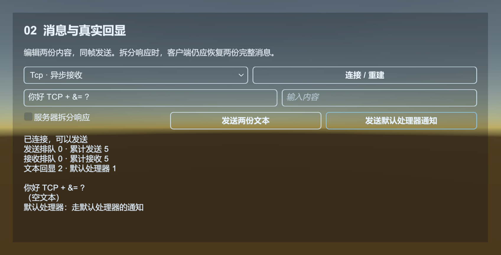

# Network：建立连接，定义自己的消息协议

Network 管理 Socket 连接、发送队列、拆包、消息分发和心跳。`INetworkChannelHelper` 实现消息协议，`Packet` 表示业务消息。

[Network 示例](../../Samples~/01_Modules/20_Network/) 自带本机 TCP 回显服务，可创建和销毁通道、发送消息、观察心跳和模拟连接失败，也能比较两种 TCP 接收方式。



HTTP 公告和账号接口使用 [WebRequest](web-request.md)。Network 示例运行 TCP 回显服务，展示连接、包头、包体编解码和消息处理；认证、加密与重连由业务协议实现。

## 先约定线上的字节

TCP 是字节流，一次 Send 与一次 Receive 不会天然一一对应。本例约定：

| 内容 | 长度 | 编码 |
| --- | --- | --- |
| 包头：包体字节数 | 4 字节 | Int32，小端 |
| 包体：消息 ID | 4 字节 | Int32，小端，本例固定 1 |
| 包体：文字 | 其余字节 | UTF-8 |

包头中的 PacketLength **只计包体，不含 4 字节包头**。限制包体为 4 到 65536 字节，先检查长度，再让框架准备接收缓冲区。上线协议需要另行定义版本、消息 ID、大小限制及非法消息处理规则。

## 定义 Packet 和 Helper

保存为 `Assets/MyGame/Scripts/TextChannelHelper.cs`。示例不依赖外部协议库。

```csharp
using System;
using System.IO;
using System.Text;
using UnityQGameFramework.Core;
using UnityQGameFramework.Core.Network;

namespace QgfDocs
{
    public sealed class TextPacket : Packet
    {
        public override int Id => 1;
        public string Text { get; set; }
        public override void Clear() => Text = null;
    }

    public sealed class TextPacketHeader : IPacketHeader
    {
        public int PacketLength { get; }
        public TextPacketHeader(int length) => PacketLength = length;
    }

    public sealed class TextChannelHelper : INetworkChannelHelper
    {
        private static readonly Encoding Utf8 = new UTF8Encoding(false, true);
        private const int MaxBodyLength = 65536;
        public int PacketHeaderLength => 4;
        public void Initialize(INetworkChannel channel) { }
        public void Shutdown() { }
        public void PrepareForConnecting() { }
        public bool SendHeartBeat() => false;

        public bool Serialize<T>(T packet, Stream destination) where T : Packet
        {
            if (!(packet is TextPacket text)) throw new InvalidDataException("未知消息类型。");
            byte[] bytes = Utf8.GetBytes(text.Text ?? string.Empty);
            if (bytes.Length > MaxBodyLength - 4) throw new InvalidDataException("消息太长。");
            using (var writer = new BinaryWriter(destination, Utf8, true))
            {
                writer.Write(4 + bytes.Length);
                writer.Write(text.Id);
                writer.Write(bytes);
            }
            return true;
        }

        public IPacketHeader DeserializePacketHeader(Stream source, out object customErrorData)
        {
            customErrorData = null;
            using (var reader = new BinaryReader(source, Utf8, true))
            {
                int length = reader.ReadInt32();
                if (length < 4 || length > MaxBodyLength)
                    throw new InvalidDataException("非法包体长度。");
                return new TextPacketHeader(length);
            }
        }

        public Packet DeserializePacket(IPacketHeader header, Stream source, out object customErrorData)
        {
            customErrorData = null;
            using (var reader = new BinaryReader(source, Utf8, true))
            {
                if (reader.ReadInt32() != 1) throw new InvalidDataException("未知消息 ID。");
                int length = header.PacketLength - 4;
                byte[] bytes = reader.ReadBytes(length);
                if (bytes.Length != length) throw new EndOfStreamException();
                string value = Utf8.GetString(bytes);
                var packet = ReferencePool.Acquire<TextPacket>();
                packet.Text = value;
                return packet;
            }
        }
    }
}
```

BinaryReader、BinaryWriter 都使用 leaveOpen，不关闭框架借给 Helper 的 Stream。接收 Packet 从引用池取得；框架完成消息处理后会归还它。这个简单 Header 是普通 C# 对象，不额外放进引用池。

## 创建通道并处理消息

场景需要 Base、Event、Network。创建 `Assets/MyGame/Scripts/NetworkExample.cs` 并挂到 GameObject：

```csharp
using System;
using System.Net;
using Cysharp.Threading.Tasks;
using UnityEngine;
using UnityQGameFramework.Core.Event;
using UnityQGameFramework.Core.Network;
using UnityQGameFramework.Runtime;
using ConnectedArgs = UnityQGameFramework.Runtime.NetworkConnectedEventArgs;
using ErrorArgs = UnityQGameFramework.Runtime.NetworkErrorEventArgs;

namespace QgfDocs
{
    public sealed class TextPacketHandler : IPacketHandler
    {
        public int Id => 1;
        public void Handle(object sender, Packet packet)
        {
            Log.Info("服务器回显：{0}", ((TextPacket)packet).Text);
        }
    }

    public sealed class NetworkExample : MonoBehaviour
    {
        private EventComponent events;
        private NetworkComponent network;
        private INetworkChannel channel;
        private string channelName;

        private async void Start()
        {
            try
            {
                await UniTask.NextFrame(destroyCancellationToken);
                events = QGF.Event;
                network = QGF.Network;
                events.Subscribe(ConnectedArgs.EventId, OnConnected);
                events.Subscribe(ErrorArgs.EventId, OnError);
                channelName = "Guide.Text." + GetInstanceID();
                channel = network.CreateNetworkChannel(channelName, ServiceType.Tcp, new TextChannelHelper());
                channel.HeartBeatInterval = 0f; // 本回显协议没有心跳消息。
                channel.RegisterHandler(new TextPacketHandler());
                channel.Connect(IPAddress.Loopback, 9000, this);
            }
            catch (OperationCanceledException) when (destroyCancellationToken.IsCancellationRequested) { }
        }

        private void OnConnected(object sender, GameEventArgs args)
        {
            var e = (ConnectedArgs)args;
            if (!ReferenceEquals(e.NetworkChannel, channel) || !ReferenceEquals(e.UserData, this)) return;
            // 本示例发送普通对象；接收对象由 Helper 从引用池取得。
            channel.Send(new TextPacket { Text = "hello QGF" });
        }

        private void OnError(object sender, GameEventArgs args)
        {
            var e = (ErrorArgs)args;
            if (ReferenceEquals(e.NetworkChannel, channel)) Log.Warning(e.ErrorMessage);
        }

        private void OnDestroy()
        {
            if (events != null)
            {
                if (events.Check(ConnectedArgs.EventId, OnConnected))
                    events.Unsubscribe(ConnectedArgs.EventId, OnConnected);
                if (events.Check(ErrorArgs.EventId, OnError))
                    events.Unsubscribe(ErrorArgs.EventId, OnError);
            }
            if (network != null && channelName != null && network.HasNetworkChannel(channelName))
                network.DestroyNetworkChannel(channelName);
            channel = null;
        }
    }
}
```

先调用 `CreateNetworkChannel`，再注册处理函数；收到 Connected 事件后发送消息。处理函数 ID 对应反序列化后的 `Packet.Id`。每个连接使用独立的通道名称和 Helper。

本例在 Start 中用 UniTask 等待一帧，使框架组件完成自己的 Start，再发起连接。正式游戏也可以将创建通道放在启动 Procedure，由登录服务长期持有。

## 本机回显服务器

保存为 `echo_server.py` 并用 `python echo_server.py` 运行，然后再启动 Unity。成功时 Console 应输出“服务器回显：hello QGF”。

```python
import socket
import struct

def read_exact(conn, length):
    data = bytearray()
    while len(data) < length:
        part = conn.recv(length - len(data))
        if not part:
            raise EOFError()
        data.extend(part)
    return bytes(data)

with socket.socket() as server:
    server.bind(("127.0.0.1", 9000))
    server.listen()
    while True:
        conn, _ = server.accept()
        with conn:
            try:
                while True:
                    header = read_exact(conn, 4)
                    length = struct.unpack("<i", header)[0]
                    if not 4 <= length <= 65536:
                        break
                    conn.sendall(header + read_exact(conn, length))
            except (EOFError, ConnectionError):
                pass
```

## 生命周期与线程边界

Core 按包头长度接收头，再按 PacketLength 接收体，交给 Helper 解码。接收 Packet 进入通道自己的 EventPool，随后在框架 Update 中分发给 Handler。连接状态的 Runtime 事件则经 EventComponent 到达业务。Helper 的 Socket 回调可能在后台线程执行，不要在序列化、解码回调中使用 Unity 对象；把业务状态更新放到主线程 Handler。

`Send(packet)` 会将对象排队，不能调用后马上 Clear 或归还。当前 Core 不统一负责发送 Packet 的引用池归还，关闭时也只是清空发送队列；所以本例发送端使用普通 new 对象。若改为池化发送，协议层必须覆盖序列化成功、失败、未连接和关闭时丢弃等所有路径的归还策略，不能只在正常 Serialize 中 Release。

接收 Handler 中不要保存 Packet 引用，读取并转换为自己的业务状态即可，也不要手动 Release 已交给通道分发的 Packet。Handler 抛异常会影响事件分发，应在协议校验和业务错误边界处处理预期失败。

| 接口 / 事件 | 作用 |
| --- | --- |
| Close | 关闭连接；通道仍归 NetworkManager 管理 |
| DestroyNetworkChannel | 关闭并移除通道，调用 Helper.Shutdown |
| NetworkClosedEventArgs | 连接关闭通知 |
| NetworkErrorEventArgs | 连接、发送、接收或编解码错误 |
| NetworkMissHeartBeatEventArgs | 心跳计时发现未收到预期响应，业务决定是否断开重连 |
| NetworkCustomErrorEventArgs | Helper 返回的协议自定义错误 |
| SendPacketCount / ReceivePacketCount | 等待处理的队列计数，不是服务端确认数 |
| SentPacketCount / ReceivedPacketCount | 通道累计发送/接收的消息数；Close 或新连接会重置 |
| SetDefaultHandler | 没有专用 Handler 的 Id 交给默认处理器 |
| GetAllNetworkChannels | 数组或复用 List，结果包含未连接的已注册通道 |

心跳需要协议真实发送与响应，不能只设置 HeartBeatInterval；重连还应处理登录恢复、请求幂等和旧消息失效。当前提供 Tcp 和 TcpWithSyncReceive 服务实现，不应把它当成 WebSocket、UDP 或浏览器 WebGL 的通用传输层。

源码：[INetworkChannelHelper](../../Runtime/Core/Network/INetworkChannelHelper.cs)、[NetworkChannelBase](../../Runtime/Core/Network/NetworkManager.NetworkChannelBase.cs)、[NetworkComponent](../../Runtime/Unity/Network/NetworkComponent.cs)。

TcpWithSyncReceive 在主线程检查可读状态并接收可用数据；服务器发送 FIN 且没有剩余字节时也会关闭连接。正常关闭发出 Closed，协议失败发出 Error，自定义业务拒绝发出 CustomError；业务应分别决定关闭、提示和恢复。
