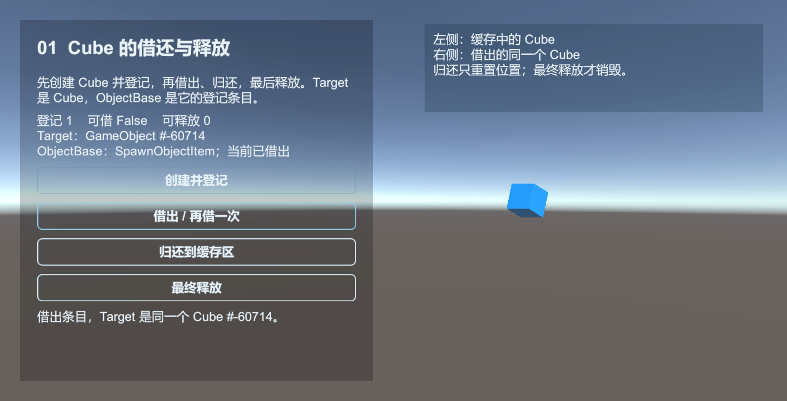
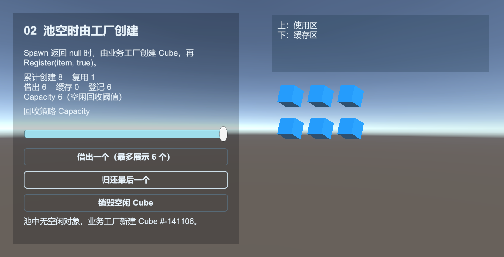

# ObjectPool：重复使用已经创建的对象

子弹、爆炸和血条经常反复出现。ObjectPool 缓存这些已创建的对象：`Spawn` 借出，`Unspawn` 归还，空闲时再按策略释放。

[ObjectPool 示例](../../Samples~/08_ObjectPool/) 用 Cube 展示借还、池空时由工厂创建、共享借用、回收策略和多池管理。借还会移动同一个 Cube，最终释放才销毁它。



ObjectPool 通过 ObjectBase 登记 Target，管理借用、容量、过期与释放。Entity、UI、Resource 内部使用它管理缓存。[ReferencePool](reference-pool.md) 用于复用事件参数等 C# 对象。

## Target 与登记条目

`Target` 是业务使用的对象，声明类型为 `object`。本例保存同一个 GameObject 引用，也可以换成 Image、AudioClip 或普通 C# 实例。

`ObjectBase` 保存 Target、名称、锁定和优先级，并提供借还与释放回调。`IObjectPool<T>` 的 T 指定条目类型。`ReferencePool.Acquire<T>()` 复用条目，`Instantiate` 创建 Cube。

| 调用 | 场景中的 Cube | 登记条目 |
| --- | --- | --- |
| Instantiate + Initialize(target) | 新建 GameObject | 保存同一个 Target 引用 |
| Register(item, false) | 不自动变化 | 登记为空闲 |
| Spawn() | OnSpawn 中恢复位置、显示等状态 | 标为借出；无空闲时返回 null |
| Unspawn(item) | OnUnspawn 中复位或隐藏，留待复用 | 借用结束；超过容量时可能进一步触发淘汰 |
| ReleaseObject(item) | 满足释放条件时进入 Release，销毁 Target | 随后由框架归还 ReferencePool |

池不决定 Target 应当怎样创建和销毁；条目回调需要按照业务资源来源实现。

借还示例可切换 `ReleaseObject(item)` 和 `ReleaseObject(item.Target)`。回收策略示例也可切换 `SetLocked`、`SetPriority` 的这两种参数。传入 Target 时，池先查找持有它的登记条目，再执行操作；两种入口使用相同的借用计数和释放条件。

## 做一个可重复显示的 Cube

场景中需要 Base 和 ObjectPool 组件。创建 `Assets/MyGame/Scripts/CubePoolExample.cs`，挂到普通 GameObject 上。运行后，在脚本的右键菜单先点 Show cube，再点 Hide cube，再次显示时会取回同一个 Cube。

```csharp
using UnityEngine;
using UnityQGameFramework.Core;
using UnityQGameFramework.Core.ObjectPool;
using UnityQGameFramework.Runtime;

namespace QgfDocs
{
    public sealed class CubePoolItem : ObjectBase
    {
        public static CubePoolItem Create(GameObject target)
        {
            var item = ReferencePool.Acquire<CubePoolItem>();
            item.Initialize("Cube", target);
            return item;
        }

        protected override void OnSpawn() => ((GameObject)Target).SetActive(true);
        protected override void OnUnspawn() => ((GameObject)Target).SetActive(false);
        protected override void Release(bool isShutdown) => Object.Destroy((GameObject)Target);
    }

    public sealed class CubePoolExample : MonoBehaviour
    {
        private ObjectPoolComponent pools;
        private IObjectPool<CubePoolItem> pool;
        private CubePoolItem current;

        private void Start()
        {
            pools = QGF.ObjectPool;
            pool = pools.CreateSingleSpawnObjectPool<CubePoolItem>(
                "Guide." + GetInstanceID(), 30f, 4, 60f, 0);
        }

        [ContextMenu("Show cube")]
        public void ShowCube()
        {
            if (pool == null || current != null) return;
            current = pool.Spawn("Cube");
            if (current != null) return;

            var target = GameObject.CreatePrimitive(PrimitiveType.Cube);
            target.transform.position = Vector3.zero;
            current = CubePoolItem.Create(target);
            pool.Register(current, true);
        }

        [ContextMenu("Hide cube")]
        public void HideCube()
        {
            if (current == null) return;
            pool.Unspawn(current);
            current = null;
        }

        private void OnDestroy()
        {
            if (pools != null && pool != null && pools.HasObjectPool<CubePoolItem>(pool.Name))
            {
                HideCube();
                pools.DestroyObjectPool(pool);
            }
            current = null;
            pool = null;
        }
    }
}
```

URP 工程如果默认材质不适合当前渲染管线，可给 Cube 指定一个 URP/Lit 材质。本例只演示对象生命周期。

上面的完整参数依次是名称、自动释放检查间隔、容量、过期秒数和池优先级。名称加实例 ID，区分不同组件创建的池。ObjectPoolComponent 转发到 Core 管理器，周期检查由框架 Update 驱动。

## 选择创建重载

SingleSpawn 与 MultiSpawn 都提供泛型和 `Type` 入口。泛型返回 `IObjectPool<T>`，`Type` 入口在最前面增加 `objectType`，返回 `ObjectPoolBase`。它们各有相同的 15 组参数组合，便于按需要补充配置。

| 参数组合 | 使用场景 |
| --- | --- |
| 无参数；name | 使用默认回收参数，按条目类型与可选池名区分 |
| capacity；name, capacity | 只设置容量 |
| expireTime；name, expireTime | 设置空闲过期时间，检查间隔采用相同秒数 |
| capacity, priority；name, capacity, priority | 设置容量与池优先级 |
| capacity, expireTime；name, capacity, expireTime | 设置容量与过期时间 |
| expireTime, priority；name, expireTime, priority | 设置过期时间与池优先级 |
| capacity, expireTime, priority；name, capacity, expireTime, priority | 同时设置容量、过期时间与池优先级 |
| name, autoReleaseInterval, capacity, expireTime, priority | 分别设置检查间隔与过期时间 |

省略 name 时使用空字符串；默认 capacity 为 `int.MaxValue`，expireTime 为 `float.MaxValue`，priority 为 0。未独立指定 autoReleaseInterval 时，它与 expireTime 相同，因此省略过期时间也会得到 `float.MaxValue` 的检查间隔。

参数类型会影响重载选择：`CreateSingleSpawnObjectPool<CubePoolItem>("Shots", 2)` 设置容量 2；把 `2` 改成 `2f`，含义就变成空闲 2 秒过期，检查间隔也为 2 秒。需要更频繁检查时，用完整重载分别传入间隔与过期时间。

多池管理示例底部可对照这 15 组参数。选择泛型/Type、单次/共享入口后创建一个空池，界面显示实际名称、容量、过期时间、检查间隔和优先级。重建只替换这份对照池，三个 Cube 池继续保留。60 个直接调用集中在 `InspectObjectPools.Creation.cs`；主脚本负责界面和清理，场景仍是原来五个。

`Capacity` 比较的是 `Count`，包含借出和空闲条目。它允许借出总数暂时超过容量；回收只挑符合条件的空闲条目。修改 Capacity 或 ExpireTime 会立即尝试回收，Register 和归还至空闲的 Unspawn 也会在超容量时尝试回收。对象满足过期条件后，会在下一次周期检查或这些主动回收操作中释放。

池优先级与条目优先级分属两层。管理器批量回收时先处理 Priority 较小的池；池内默认策略先选出已过期条目，再按条目 Priority 从小到大补足回收数量，同级时优先释放更早空闲的条目。

## Register、Spawn 和 Unspawn

`Register(item, true)` 将新对象登记为已借出，会执行一次 OnSpawn 并把借用计数设为 1。下一步应归还它；不要再调用 Spawn。

`Register(item, false)` 把对象登记为空闲，适合预热。先自行隐藏 Target，之后由 Spawn 取出。Register 本身不会替你隐藏它。

`Spawn(name)` 在池空时返回 null，由业务在这个分支创建 Cube。`Unspawn` 结束借用并触发 OnUnspawn，目标留在缓存中。登记数量超过 Capacity 时，池会尝试回收空闲条目；被淘汰的条目调用 Release 并回收包装对象。

| 选项 | 实际含义 |
| --- | --- |
| SingleSpawn | 同一个池对象同时只能被借出一次，适合 Cube、血条 |
| MultiSpawn | 允许对同一个对象多次 Spawn，累计计数；每次借出都必须 Unspawn，适合共享资源 |
| Capacity | 与登记总数比较的回收阈值，借出的条目仍保留 |
| ExpireTime | 空闲对象满足过期条件后可以被淘汰 |
| Locked / CustomCanReleaseFlag | 阻止普通淘汰；关闭整个池仍要执行清理 |
| Release / ReleaseAllUnused | 按策略释放 / 尝试释放全部符合条件的空闲对象 |

共享示例按 `CanSpawn("Cube")` 判断能否借用，并显示 `SpawnCount` 与 `IsInUse`。MultiSpawn 的条目在使用中仍可再次借出；示例最多显示三个使用者，这是界面限制。

回收策略示例把默认 `Release()`、指定数量和自定义筛选放在同一下拉框中。默认策略保留未超容量且未过期的对象；“全部 Temp”回调返回所有符合条件的 Temp，“一个 Temp”只返回一个。Core 逐个尝试释放回调返回的条目，`requested` 是提供给回调的目标数量，最终数量由返回列表决定。

## 池空时由工厂创建

`Spawn` 返回 null 后，由业务创建 Target，再用 `Register(item, true)` 登记为已借出。可运行示例见 [02 池空时由工厂创建](../../Samples~/08_ObjectPool/02_Factory/)；场景显示创建、归还和复用的多个 Cube。



工厂写在业务侧。若提取 SpawnOrCreate(pool, factory)，让工厂登记与 Spawn(name) 相同的名称；Spawn() 对应空名称。

## 写池对象的约定

OnSpawn 恢复可用状态，OnUnspawn 停止动画、协程、粒子或隐藏对象。Release 释放 Target 真正持有的资源。如果 Target 来自 Resource.LoadAsset 的实例，还要按照自己的引用关系卸载资产，不能只 Destroy 场景对象。

上面的隐藏方式适合 SingleSpawn。MultiSpawn 的 OnSpawn、OnUnspawn 每次借还都会触发，第一次归还不代表所有使用者都已结束；共享 Target 的最终清理放在 Release。可通过 `GetAllObjectInfos()` 查看 SpawnCount、IsInUse、锁定、优先级与 LastUseTime 的快照。

借还使用 `IObjectPool<T>`；信息查询方法位于 `ObjectPoolBase`，示例用 `((ObjectPoolBase)pool).GetAllObjectInfos()` 查看同一台池。返回值是条目信息的快照。

多池管理示例的单池查询会显示标识、借用方式、可释放数量和回收参数。`ObjectType` 是 `RegistryItem` 这类登记条目类型；`FullName` 由该类型与池名组成，用来区分不同池，界面省略了示例命名空间。通过 `Type` 取得的 `ObjectPoolBase` 也能直接回收：`Release()` 遵守当前策略，`Release(1)` 尝试回收一个空闲目标，`ReleaseAllUnused()` 尝试回收全部空闲目标。这三种操作只影响 Left；管理器上的对应方法才会遍历所有池。释放内容后，池仍然可以登记新目标，`DestroyObjectPool` 才移除整个池。

回收策略示例显示实际的 `AutoReleaseInterval`，选中条目时读取 `ObjectBase.LastUseTime`。它使用 UTC，随初始化、借出和归还更新；界面的空闲秒数则来自 `ObjectInfo` 快照。条目释放后可能被 ReferencePool 复用，因此先用快照确认它仍属于池，再读取条目。

需要额外字段时重写 Clear，调用 base.Clear，再清空自己的引用。Clear 会在包装对象最终归还 ReferencePool 时执行，不能依赖它在每次 Unspawn 时重置业务状态。业务程序集重写 ObjectBase 中的 protected internal 成员时使用 `protected override`。

不要直接 Destroy 正在池中登记的 Target；不要重复 Unspawn，也不要把池拥有的 ObjectBase 手动 ReferencePool.Release。停用一个业务系统时，先归还它借出的对象，再由拥有者销毁对应池。

源码：[ObjectBase](../../Runtime/Core/ObjectPool/ObjectBase.cs)、[IObjectPool](../../Runtime/Core/ObjectPool/IObjectPool.cs)、[ObjectPoolManager.ObjectPool](../../Runtime/Core/ObjectPool/ObjectPoolManager.ObjectPool.cs)、[ObjectPoolComponent](../../Runtime/Unity/ObjectPool/ObjectPoolComponent.cs)。
