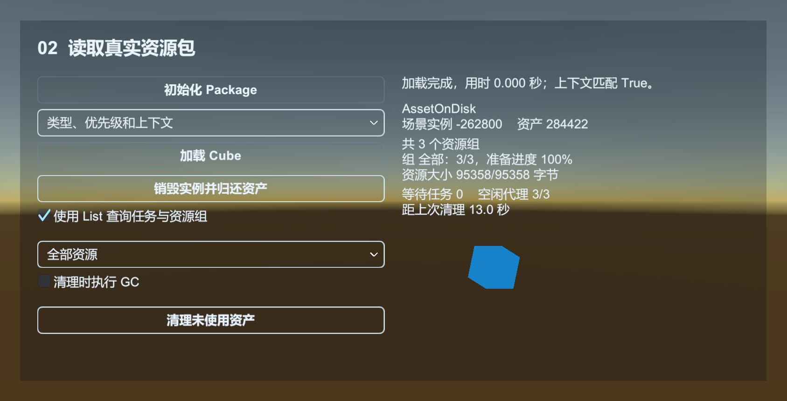

# Resource：加载一个预制体，并正确归还资源

Resource 负责资产定位、依赖加载、任务调度和缓存。它加载的是预制体资产，不会自动把预制体变成游戏中的实例。Entity 和 UI 在它上面继续完成实例化与复用。

## 准备一个 Cube 预制体

可运行的 Resource 示例包含预制体、资源包、二进制资源和更新场景，见 [Resource 示例](../../Samples~/01_Modules/12_Resource/)。

| 示例 | 操作与观察 |
| --- | --- |
| 01_LoadPrefab | 编辑器直读一个资产，创建两个 Cube，再分别销毁和归还 |
| 02_Package | 初始化资源包，加载 Cube 资产、创建实例，再销毁并归还资产 |
| 03_Binary | 异步读取磁盘中的完整文件，再从文件系统资源读取指定片段 |
| 04_Update | 通过本机 HTTP 下载清单和资源，按组更新、停止、重试并加载 Cube |
| 05_ResourcePack | 校验完整包与损坏副本，应用本地资源包，再加载 Cube |
| 06_VerifyCache | 校验已有缓存，检测散文件或容器内容损坏，只重新下载损坏资源 |
| 07_Variant | 按变体初始化，读取不同数值并改变 Cube，比较内置处理与自定义还原回调 |
| 08_Cache | 查看资产与资源池的借用、缓存和回收，比较过期策略与 Unity 清理时机 |
| 09_OnDemand | 直接加载触发下载，对比二进制预更新，模拟失败并恢复原加载任务 |

02 至 09 使用当前 Unity 版本构建的 Windows64 资源。停止 Play，执行 `QGF > Examples > Build Resource Fixtures`，再运行场景。构建产物位于 `Library/QgfExamples/Resources/<Unity版本>`；移动示例目录后重新执行一次构建。菜单使用自己的 Collection 和 Builder 配置，不修改全局配置、StreamingAssets 或项目设置。

04 使用 Updatable 模式，每次运行分配空缓存。本机服务直接提供构建后的 Full 文件，不需要外部服务器。先下载版本清单，再检查资源，最后更新所选组。只更新 Base 就能加载 Cube，Data 组可以稍后下载。勾选模拟故障后，资源请求返回 404；重试耗尽会结束本次更新，关闭故障开关后可以再次点击更新。

`VerifyResources` 校验已有缓存的 CRC，要在 `CheckResources` 前调用。04 的首次缓存为空，校验不会产生下载；是否缺失、需要下载多少，由后续检查结果决定。`StopUpdateResources` 停止安排后续资源，当前下载继续执行，且不触发被停止那次调用的完成回调。示例等当前下载结束后才允许继续安排。

05 的资源包由构建菜单生成，包含三个资源。`VerifyResourcePack` 只校验包的长度与 CRC；`ApplyResources` 在检查完成后，把所需资源写入可写区。这里的资源包可以随安装程序分发，也可以作为单文件下载。示例只通过 HTTP 获取版本清单，应用时不逐个下载资源。损坏开关修改的是当前运行的副本，不会改动原包。

06 从构建的 Packed 目录复制资源，并用框架序列化器把只读清单转换成读写清单，模拟上次运行留下的缓存。选择改动一字节、截短散文件或修改容器文件后，`VerifyResources` 会删除损坏条目并返回 false；接着调用 `CheckResources`，只需下载缺少的那一个资源。完整缓存不需要下载资源文件。每次运行都使用独立副本，可以重新运行比较不同情况。

02 的集合查询可合并多个命名资源组。Shared 含 Cube、Archive，Base 含 Cube；合并后是两个唯一资源。默认组的空名称不用于集合查询。`HasResourceGroup` 用于先确认组名是否注册。集合用于统计资源准备情况，更新入口仍是 `UpdateResources` 的组名参数。

04 使用 `GetResourceGroup` 查询 Base 和 Data 的准备状态，并合并成一个 `IResourceGroupCollection`。更新清单提供的压缩长度可观察尚未下载、只准备好 Base、全部就绪三种状态。

`ReadyLength`、`ReadyCompressedLength` 只累加完整就绪的资源；`Progress` 按原始资源长度计算。它们会在一个资源完成时跳变。单个文件已传输多少字节，看 `ResourceUpdateChangedEventArgs.CurrentLength`；不要把组进度当成该文件的连续下载进度。

07 在独立的变体清单中构建 normal、hard 两份二进制数据和共同的 Cube。normal 使用快速还原格式，hard 使用完整还原格式，读取结果都能正常解析。`SetCurrentVariant` 要在初始化前调用，初始化后只登记当前变体及无变体资源。两份数据的资产路径各不相同；变体不会把一个资产路径自动改写成另一个路径。

还原回调必须在加载代理创建前登记。因此 07 场景先禁用 Resource 组件，在初始化按钮中通过 Core 接口设置回调，再启用组件，等待它完成 Start 后初始化。未注册回调时使用框架内置处理。这里沿用构建器的异或格式，回调演示如何还原传入的数据区间；更换格式时也要同步修改构建端。

内置异或处理支持按源文件偏移读取加密片段。自定义回调不含源偏移参数，因此加密片段会先读取并还原完整资源，再取出请求区间；自定义格式需要考虑这部分内存与读取成本。

08 使用三组参数比较缓存行为：保留缓存、容量为零时归还即回收、两秒过期后定时回收。`Asset*` 参数控制资产池，`Resource*` 参数控制底层资源池。资产引用归还后可以仍留在资产池，底层 Bundle 此时也仍被它借用；资产池回收后，资源池才可能回收 Bundle。容量是回收目标，不是加载上限，也不会预创建资产。

`UnloadUnusedAssets` 请求 Unity 清理，达到 `MinUnloadUnusedAssetsInterval` 才执行；`ForceUnloadUnusedAssets` 跳过最小间隔。即使没有预订，到达 `MaxUnloadUnusedAssetsInterval` 也会触发清理。这两种调用不会主动清空 QGF 对象池。界面显示池中数量和借用计数、距上次 Unity 清理的时间，可分别观察两层回收。

09 使用 UpdatableWhilePlaying，每次从空缓存开始。清单下载并检查完成后，直接 `LoadAsset` 会先下载缺失的 Bundle 及依赖，再执行加载成功回调；Data 组不会随 Cube 一起下载。`HasAsset` 在这种模式下能报告尚未下载的资产类型和位置，不能据此判断资源已就绪，准备情况看资源组的 `Ready`。

`LoadBinary` 不触发按需下载。示例先读取缺失的二进制，得到 `NotReady`，更新 Data 组后再读同一路径。界面分别显示按需下载队列、按组更新队列、加载任务和当前更新组。`GenerateReadWriteVersionListLength` 控制累计下载多少字节后保存本地清单；一批下载结束时也会保存。

09 的故障开关让资源请求返回 404。下载重试耗尽后会发出 `ResourceUpdateFailureEventArgs`，但原 `LoadAsset` 仍在等待，不会因此收到资产失败回调。关闭故障并补下载 Base 后，同一个加载请求继续完成。示例只提交一次加载；自行封装超时或取消界面时，也要处理这个尚未结束的任务和可能迟到的成功回调。



下面从新建自己的资源开始，说明同样的调用怎样写进游戏流程。

在场景创建 Cube，拖到 `Assets/MyGame/Prefabs/Cube.prefab`，然后删除场景中的原对象。给它选择与当前渲染管线兼容的材质。

场景放入框架预制体，Base 勾选 Editor Resource Mode。把下面的 `ResourceGuideProcedure` 选为入口流程。

```csharp
using UnityEngine;
using UnityQGameFramework.Core.Fsm;
using UnityQGameFramework.Core.Procedure;
using UnityQGameFramework.Core.Resource;
using UnityQGameFramework.Runtime;

namespace QgfDocs
{
    public sealed class ResourceGuideProcedure : ProcedureBase
    {
        private ResourceComponent resources;
        private object request;
        private Object loadedAsset;
        private GameObject instance;

        protected override void OnEnter(IFsm<IProcedureManager> owner)
        {
            base.OnEnter(owner);
            resources = QGF.Resource;
            request = new object();
            resources.LoadAsset("Assets/MyGame/Prefabs/Cube.prefab", typeof(GameObject),
                new LoadAssetCallbacks(OnLoaded, OnFailed), request);
        }

        private void OnLoaded(string name, object asset, float duration, object userData)
        {
            if (!ReferenceEquals(userData, request))
            {
                resources.UnloadAsset(asset);
                return;
            }
            loadedAsset = (Object)asset;
            instance = Object.Instantiate((GameObject)loadedAsset);
            instance.transform.position = Vector3.zero;
        }

        private void OnFailed(string name, LoadResourceStatus status, string message, object userData)
        {
            if (ReferenceEquals(userData, request)) Log.Error(name + ": " + message);
        }

        protected override void OnLeave(IFsm<IProcedureManager> owner, bool isShutdown)
        {
            request = null;
            if (instance != null) Object.Destroy(instance);
            if (loadedAsset != null) resources.UnloadAsset(loadedAsset);
            instance = null;
            loadedAsset = null;
            base.OnLeave(owner, isShutdown);
        }
    }
}
```

运行后 Hierarchy 中出现 Cube 实例；能否在 Game 中看见，还取决于自己的摄像机位置。这个例子用每次请求独立的 token，防止旧请求在流程重新进入后被当作新结果处理。

## 编辑器资源模式与发行模式

| 模式 | 由谁完成资源读取 | 需要准备什么 |
| --- | --- | --- |
| 编辑器资源模式 | EditorResourceComponent | Assets 下真实存在的资产；完整路径 |
| Package | ResourceManager 与默认加载辅助器 | 已构建的资源、包内资源清单、正确的只读路径和 InitResources |
| Updatable / UpdatableWhilePlaying | ResourceManager、Download、FileSystem 等 | 版本清单、更新地址、资源校验和更新流程 |

Base 的 Editor Resource Mode 仅在编辑器有效，不能让 Player 使用 AssetDatabase。运行时的路径仍是逻辑资产名，框架通过版本清单找到所在资源包，不是直接到 Assets 文件夹找文件。

资源示例的 `ResourceExamplePaths.Awake` 在加载代理创建前设置 Core 资源管理器的只读区与可写区。ResourceComponent.Start 保留预设值；未预设时仍使用 StreamingAssets 和组件选择的持久化或临时目录。路径只能在初始化前设置。

当前编辑器加载入口要求以 `Assets/` 开头。包内源码与预制体可以在 Editor 中直接引用、拖入场景，但不要把 `Packages/...` 当作这个入口支持的游戏资产路径。自己的动态资源放进 Assets 或按自己的资源方案扩展。

资源模式通常在 Resource 组件的 Inspector 中选择，组件 Start 会设置它并注册内置清单格式。`SetResourceMode` 用于启动配置，初始化后不能切换另一种模式。`ReadWritePathType` 选择持久化或临时缓存目录；示例预设独立路径，因此不使用项目的正常缓存。

## 组件与 Core 接口的分工

发行资源模式下，`QGF.Resource` 将调用交给 Core 的 `IResourceManager`；编辑器直读分支由 EditorResourceComponent 处理。组件的加载、二进制和更新重载通常补齐类型、优先级、上下文或缓冲区范围，再调用管理器。Core 的较短重载也有部分直接进入同一个内部 ResourceLoader；它们不一定先调用 Core 的最长重载。

场景加载是另一条路径：`QGF.Scene → ISceneManager → IResourceManager.LoadScene / UnloadScene`。场景事件、已加载列表和活动场景由 Scene 模块组织；[Scene 示例](../../Samples~/01_Modules/16_Scene/)演示这层用法。

`SetObjectPoolManager`、`SetFileSystemManager`、`SetDownloadManager`、`SetResourceHelper` 和代理 Helper 的添加由 ResourceComponent.Start 完成。只读/可写路径、模式、变体和还原回调需要在相应初始化阶段设置，示例的 Common、07_Variant 说明了这些时机。

各 `*VersionListSerializer` 属性返回管理器持有的清单序列化器，组件在启动时按模式登记内置格式。它们用于资源构建、版本清单和自定义格式；06_VerifyCache 也用读写清单格式准备测试缓存。一般资产加载不需要替换这些回调。

`ReadWritePathType` 返回 Inspector 中选择的目录策略；实际读写位置读 `ReadWritePath`。`02_Package` 会并排显示资源模式、只读区和读写区路径，路径相对于本机示例产物目录。示例在初始化前预设了独立目录，因此实际路径来自这个预设。

以下属性取得二进制资源清单的序列化器，用于接入清单格式。沿用框架构建器时使用内置注册；自定义格式时，构建端和读取端一起调整。

| 属性 | 处理的内容 |
| --- | --- |
| PackageVersionListSerializer | 随安装包提供的资源清单 |
| UpdatableVersionListSerializer | 远端更新版本清单 |
| ReadOnlyVersionListSerializer | 只读区本地清单 |
| ReadWriteVersionListSerializer | 可写区本地清单 |
| ResourcePackVersionListSerializer | 可导入资源包的包头与清单 |

06 缓存示例在准备数据时通过 Core 序列化器把只读清单转换成读写清单。游戏配置仍分别由 Config 的 TOML 解析器和 Luban 处理。

资源解密回调通过 `ResourceComponent.SetDecryptResourceCallback` 设置。07 示例先注册回调，再启用 Resource 组件；`Start` 创建加载代理后不能更改回调。组件支持在 Awake 或启用前把配置交给 Core 管理器。

## 资产和实例谁来释放

LoadAsset 获得的是受管理资产引用。UnloadAsset 归还这一次加载的使用关系，不保证立即销毁或卸载整个 AssetBundle；内部缓存和其他使用者也会影响释放时机。

上例自行 Instantiate，因此它也自行 Destroy 实例。要先结束实例对资产的使用，再归还对应资源。不要把某个资源提供给仍然存活的实例后，立即强制卸载其依赖。

如果使用 Entity.ShowEntity 或 UI.OpenUIForm，不要再对它们内部取得的预制体手动 Load/Unload 一遍；让对应模块维护内部实例池和资源引用。

## 回调与失败

LoadAssetCallbacks 可以指定成功、失败、进度和依赖加载回调。assetName 用来定位失败资源，userData 用来关联调用者；duration 用于观察加载耗时，不是资源的有效期。

校验、导入资源包和下载更新使用另一组事件。Core 的 IResourceManager 发出 C# 事件，ResourceComponent 将它们转为 `UnityQGameFramework.Runtime` 中的事件参数，经 `QGF.Event` 分发。

| 操作 | 事件 | 对应示例 |
| --- | --- | --- |
| 校验缓存 | ResourceVerifyStart / Success / Failure | 06_VerifyCache，显示总数、有效与损坏数量 |
| 导入资源包 | ResourceApplyStart / Success / Failure | 05_ResourcePack，监听成功并显示实际资源组状态 |
| 下载更新 | ResourceUpdateStart / Changed / Success / Failure / AllComplete | 04_Update，监听字节进度和失败；09_OnDemand，观察失败重试 |

UpdateSuccess 表示一个资源下载完成，AllComplete 在全部待更新候选处理完毕后触发，导入资源包也可能使它触发。只更新一个资源组时，用该组的完成回调判断结果，不能把它与 AllComplete 混用。加载资产本身仍由那次 LoadAssetCallbacks 通知。

Unity 业务订阅 Runtime 参数的 EventId，回调中复制需要显示的字段，在退出时解除订阅。Core 与 Runtime 中有同名参数类型，同时引用两个命名空间时用别名区分。纯 C# 宿主才直接订阅 Core 事件。

普通资产加载没有返回一个可随意取消的 LoadAsset 序列号。业务离开时可以使 token 失效；旧请求成功后立即归还资产，不再创建实例。不要只取消 UI 的显示，却忘记处理迟到的资产引用。

`HasAsset` 返回的是 HasAssetResult，应按枚举含义判断，不是 bool。LoadBinary 和文件系统读取入口用于二进制资源；Luban 的 Catalog 直接引用和经 Resource 加载两种方式见[配置表示例](../02-data-tables.md)。

## 三种常见误用

1. **编辑器正常，Player 找不到资源**：没有构建资源或没有初始化运行时资源清单，仍依赖编辑器模式。
2. **关闭界面后资源还在**：Close 是回池，缓存中的实例和其他使用者可能仍持有资产；不要据此立即调用强制卸载。
3. **白色或粉色画面但加载无报错**：继续检查贴图是否完整、材质 Shader 与渲染管线是否匹配。资源名正确不证明文件内容正确。

资源发布的完整步骤见[资源构建与更新](resource-build.md)。

源码：[ResourceComponent](../../Runtime/Unity/Resource/ResourceComponent.cs)、[EditorResourceComponent](../../Runtime/Unity/Resource/EditorResourceComponent.cs)、[ResourceManager](../../Runtime/Core/Resource/ResourceManager.cs)、[加载辅助器](../../Runtime/Unity/Resource/DefaultLoadResourceAgentHelper.cs)。
