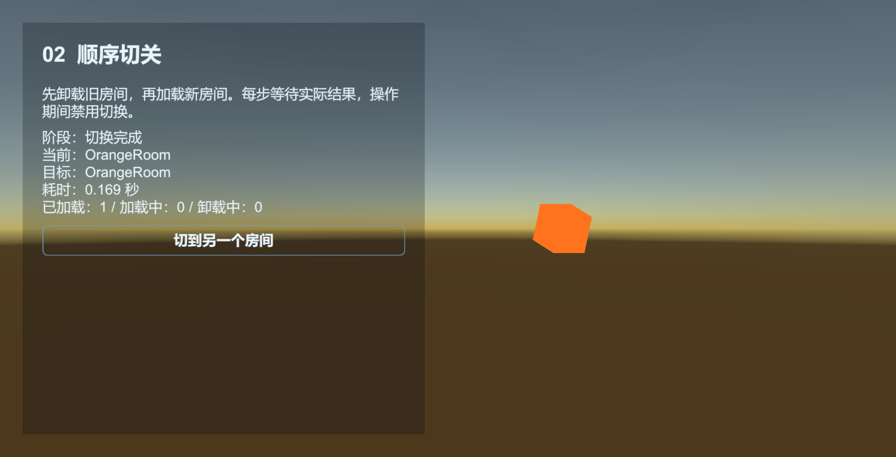
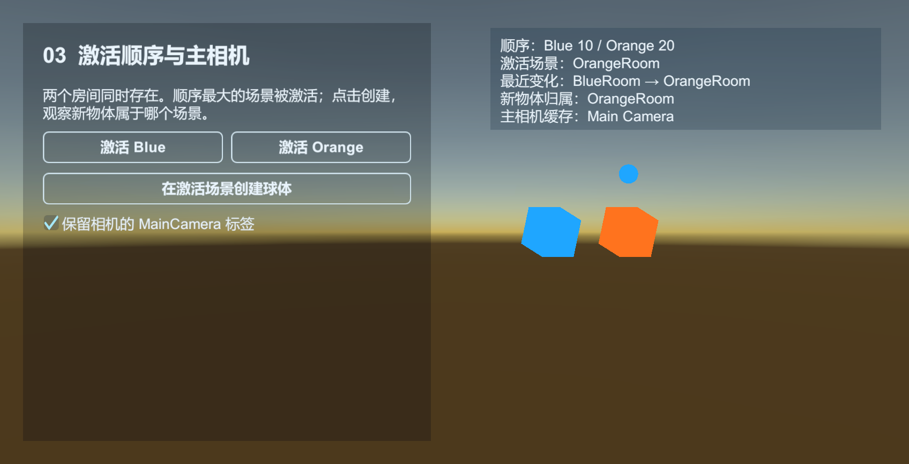

# Scene：加载场景与等待完成

Scene 通过资源模块加载和卸载游戏场景，并记录各场景的当前状态。业务传入 ResourceBuildProfile 中配置的 YooAsset 地址或资产 GUID。

[Scene 示例](../../Samples~/01_Modules/16_Scene/) 带有独立房间，可操作加载与卸载和切换房间。下图是切换到橙色房间后的结果。



## 准备一个目标场景

创建并保存 `Assets/MyGame/Scenes/Room.unity`，放一个能辨认的物体。将场景加入 ResourceBuildProfile 的收集规则，启用 `EnableAddressable` 并使用 `AddressByFileName`；Launcher 保留框架根节点和已配置的 ResourceComponent。

下面完整流程加载 Room，并在成功时打印路径：

```csharp
using UnityEngine;
using UnityQGameFramework.Core.Event;
using UnityQGameFramework.Core.Fsm;
using UnityQGameFramework.Core.Procedure;
using UnityQGameFramework.Runtime;

namespace QgfDocs
{
    public sealed class SceneGuideProcedure : ProcedureBase
    {
        private const string Room = "Room";
        private EventComponent events;
        private SceneComponent scenes;

        protected override void OnEnter(IFsm<IProcedureManager> owner)
        {
            base.OnEnter(owner);
            scenes = QGF.Scene;
            events = QGF.Event;
            events.Subscribe(LoadSceneSuccessEventArgs.EventId, OnLoaded);
            events.Subscribe(LoadSceneFailureEventArgs.EventId, OnFailed);
            scenes.LoadScene(Room, this);
        }

        private void OnLoaded(object sender, GameEventArgs e)
        {
            var args = (LoadSceneSuccessEventArgs)e;
            if (ReferenceEquals(args.UserData, this)) Log.Info("场景已加载：" + args.SceneAssetName);
        }

        private void OnFailed(object sender, GameEventArgs e)
        {
            var args = (LoadSceneFailureEventArgs)e;
            if (ReferenceEquals(args.UserData, this)) Log.Error(args.ErrorMessage);
        }

        protected override void OnLeave(IFsm<IProcedureManager> owner, bool isShutdown)
        {
            events.Unsubscribe(LoadSceneSuccessEventArgs.EventId, OnLoaded);
            events.Unsubscribe(LoadSceneFailureEventArgs.EventId, OnFailed);
            if (!isShutdown && scenes.SceneIsLoaded(Room)) scenes.UnloadScene(Room);
            base.OnLeave(owner, isShutdown);
        }
    }
}
```

在 Procedure 中选择这个入口并运行。Hierarchy 应同时存在 Launcher 和 Room。加载游戏场景并不会替你创建玩家，也不表示该场景里的全部业务初始化已经完成。

## 编辑器与 Player 的资源准备

编辑器和 Player 都通过 ResourceComponent 使用 YooAsset。编辑器模拟模式根据对应 ResourceSettings 查找 ResourceBuildProfile；Player 使用 Offline 或 Host 包加载构建后的场景资源。不要直接从 Room 点击 Play 来绕过 Launcher 的初始化。

## 查询状态，避免重复请求

| 方法 | 含义 |
| --- | --- |
| HasScene | 资源层面是否有这个场景 |
| SceneIsLoading | 这条场景加载是否正在进行 |
| SceneIsLoaded | 是否已经在 Scene 模块的已加载记录中 |
| SceneIsUnloading | 是否正在卸载 |
| GetLoadedSceneAssetNames | 取得当前模块记录的全部已加载游戏场景 |

已加载、正在加载或正在卸载同一个场景时再次 LoadScene，会被状态检查拒绝。卸载后立即重载，也要等 UnloadSceneSuccess 再请求。

## 激活场景与主相机

`SetSceneOrder` 选择最大顺序对应的场景作为 Unity 激活场景。加载中可以先登记顺序，加载完成时应用。激活场景决定未指定归属的新物体进入哪个场景，不会自动隐藏其他场景、移动已有物体或改变加载优先级。

`ActiveSceneChangedEventArgs` 带回上一个和当前激活场景。卸载后会选择剩余场景中的最大顺序；没有游戏场景时回到框架场景。第三个示例同时展示两个房间，点击创建可验证物体归属。



## UniTask、取消与切换

需要顺序执行场景操作时，可以直接等待 Scene 组件：

```csharp
await QGF.Scene.LoadSceneAsync(room, cancellationToken);
await QGF.Scene.UnloadSceneAsync(room, cancellationToken);
```

加载失败会抛出 `FrameworkException`。取消加载会结束当前等待；Unity 无法中止已经开始的场景加载，QGF 会在加载完成后补偿卸载。取消卸载只结束当前等待，不会中止已经发出的卸载请求。不要在取消后立即重载同一场景，先确认 `SceneIsLoading` 和 `SceneIsUnloading` 均为 false。

事件式 `LoadScene` / `UnloadScene` 仍适合由事件驱动界面的示例。三个示例共用 `SceneExampleCleanup`：控制器退出后，由仍存活的清理器等待请求结束并卸载自己申请的房间；框架退出时取消等待。切换示例同时记录当前房间与待加载路径，其他业务加载的场景继续保留。

## 摄像机

Scene.MainCamera 是组件维护的摄像机引用，自己的摄像机变化后可调用 RefreshMainCamera。摄像机叠加、URP Renderer 和画面布局仍由项目设置；Scene 不会自动把新项目改成某个渲染管线。

源码：[SceneComponent](../../Runtime/Unity/Scene/SceneComponent.cs)、[SceneManager](../../Runtime/Core/Scene/SceneManager.cs)、[ResourceComponent](../../Runtime/Unity/Resource/ResourceComponent.cs)。
