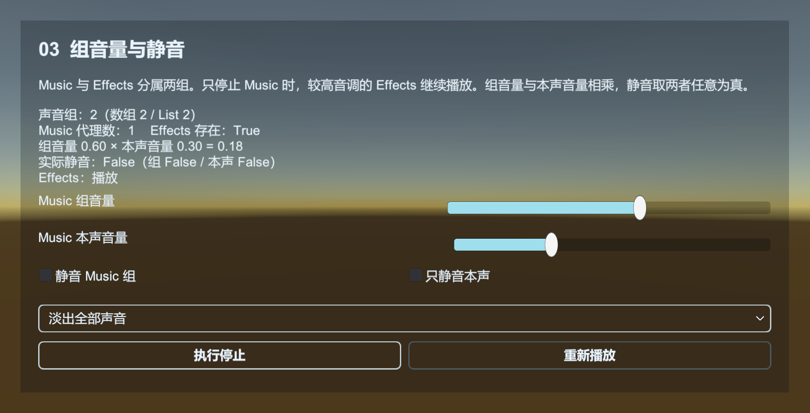
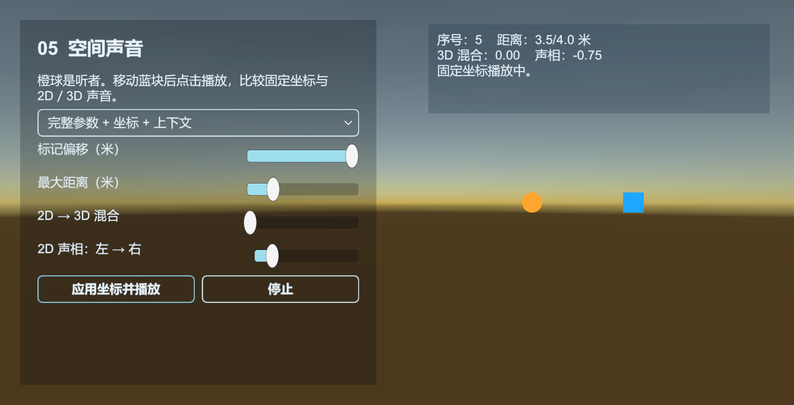
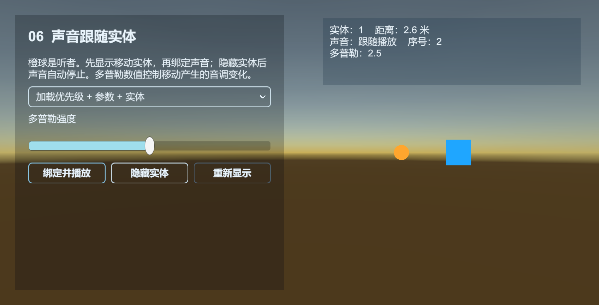

# Sound：播放、分组与保存音量

Sound 管理声音组、播放请求和播放代理。资源模块加载 AudioClip，Unity 层的 SoundAgentHelper 用 AudioSource 播放。

[Sound 示例](../../Samples~/15_Sound/) 自带 WAV，可播放和取消音效、暂停并调整进度、修改分组音量、比较代理抢占，以及在固定坐标或实体上播放。



## 播放一段循环音乐

准备 `Assets/MyGame/Audio/GuideMusic.wav`，在 Inspector 确认能预览。Base 开启编辑器资源模式，创建下面完整入口流程：

```csharp
using UnityQGameFramework.Core.Fsm;
using UnityQGameFramework.Core.Procedure;
using UnityQGameFramework.Core.Sound;
using UnityQGameFramework.Runtime;

namespace QgfDocs
{
    public sealed class SoundGuideProcedure : ProcedureBase
    {
        private SoundComponent sounds;
        private int serialId;

        protected override void OnEnter(IFsm<IProcedureManager> owner)
        {
            base.OnEnter(owner);
            sounds = QGF.Sound;
            if (!sounds.HasSoundGroup("GuideMusic")) sounds.AddSoundGroup("GuideMusic", 2);
            sounds.GetSoundGroup("GuideMusic").Volume = 0.3f;
            var parameters = PlaySoundParams.Create();
            parameters.Loop = true;
            parameters.SpatialBlend = 0f;
            serialId = sounds.PlaySound("Assets/MyGame/Audio/GuideMusic.wav", "GuideMusic", parameters);
        }

        protected override void OnLeave(IFsm<IProcedureManager> owner, bool isShutdown)
        {
            sounds.StopSound(serialId, 0.2f);
            base.OnLeave(owner, isShutdown);
        }
    }
}
```

场景中还需要有效的 AudioListener。若无声音，先检查系统与 Game 视图静音、Listener、组音量、音频资产，再看加载失败事件。

## 组和播放代理

音乐、场景音效、UI 音效通常分别建组。组控制整体 Mute、Volume 和是否允许同优先级替换；播放代理数决定并发播放能力。

AddSoundGroup 的代理数量不是“预加载多少首音乐”。一个代理使用一个播放辅助器，默认对应 AudioSource。代理忙碌时，管理器会根据优先级和组规则决定是否替换或报告播放失败。

配置表中的音效 Id 与 PlaySound 返回的 serialId 不同。StopSound 需要后者。

## 参数与事件

PlaySoundParams 可配置 Loop、Priority、VolumeInSoundGroup、FadeInSeconds、Pitch、SpatialBlend 等。用 Create 得到的参数按一次请求使用，播放请求处理后由框架归还；不要缓存它、并发复用它或自己再次 Release。

需要知道播放是否真正开始时，订阅 `PlaySoundSuccessEventArgs`；失败看 `PlaySoundFailureEventArgs` 的错误信息。拿到 serialId 不代表音频已经加载并开始播放。

某个声音仍在加载时也可以 StopSound，管理器会记录不再播放的请求。自然播放结束的非循环声音会释放代理，不要求调用方再执行一次 Stop。

## 暂停、恢复与位置

`PauseSound(serialId)` 保留资源与位置；`ResumeSound(serialId)` 从原位置继续。传入时长可淡出后暂停或淡入恢复。默认辅助器将暂停视为代理仍被占用，避免提前回收；它的 `IsPlaying` 在暂停中仍为 true，底层 AudioSource 则停止推进时间。

成功事件取得的 `ISoundAgent` 提供 `Time`、`Length`、`Loop`、`Pitch` 和组内音量等属性。代理会复用，缓存引用后应检查 `SerialId` 是否仍匹配请求。

暂停示例可切换“按播放序号操作”和“直接操作当前代理”，两种方式共用同一个声音。代理方式演示 `Pause`、`Resume`、`Stop` 的立即与淡出重载；`Play` 从头重播已加载的音频，保留序号，也不重新加载资源。重播前恢复本例的基础音量，避免把暂停时降为零的输出继续用于播放。

`Reset` 会归还音频资源引用、清掉 AudioClip 并恢复播放参数，代理本身仍留在组内。示例在重置后启用“重新播放”，通过组件再次加载；不能对已清空的代理直接 Play。普通业务保存 serialId 即可；直接操作代理时，每次先确认它仍属于自己的请求。

优先级示例保存每次播放的序号，退出时逐个停止自己的请求。已被替换的旧序号不会停止复用该代理的新声音。实体跟随示例同时隐藏自己创建的发声实体，包括仍在加载的显示请求。

组音量乘以组内音量得到输出音量，组与本声任意一个静音就会静音。`PlaySoundParams.Priority` 控制代理抢占，数值越大越优先；`PlaySound` 方法的 priority 参数控制资源加载顺序。

## 2D 声音与空间声音

普通 UI 声音将 SpatialBlend 设为 0。空间声音可以传世界坐标，或绑定到 Entity 随其位置更新。声音的距离衰减、Listener 位置和场景坐标需要一起检查。

空间声音示例用橙色球标记 AudioListener、蓝色方块标记声源。坐标重载仅设置本次播放的位置；实体绑定重载由默认辅助器跟踪 EntityLogic 的可用状态和位置，实体隐藏后自动停止。`DopplerLevel` 控制多普勒效果，`PanStereo` 用于 2D 声相。





## 声音组、代理与 Mixer

`ISoundGroup.Name` 是创建组时的名称，`ISoundAgent.SoundGroup` 指向代理所属的组。成功事件返回代理后，可由 `agent.SoundGroup.Name` 确认本次播放的分组。

`QGF.Sound.AudioMixer` 返回 Inspector 中配置的 Mixer。创建声音组时，组件先查找 `Master/组名`，找到后绑定第一个匹配的 AudioMixerGroup；没有匹配项时使用 Master。`ISoundGroup.Helper` 连接组节点与 MixerGroup，`ISoundAgent.Helper` 连接具体声音与 AudioSource。

组音量示例显示当前代理所属组、实际组辅助器类型和已配置的 Mixer 名称。默认不分配 Mixer，声音直接输出；需要混音分组时在 SoundComponent 上指定资产，再按组名配置对应路由。

业务按 serialId 调用 SoundComponent 的播放、暂停、恢复和停止方法。代理上的同名方法把操作交给已绑定的辅助器，资源加载和代理分配仍由管理器完成。`Reset()` 归还音频资源引用并重置播放参数，由换资源和辅助器重置事件驱动。缓存的代理可能已被下一路声音复用，使用前先核对 SerialId。

## 与 Setting 如何配合

玩家音量偏好由 Setting 保存。设置界面读取音量并应用到声音组；修改时同步更新组和 Setting，确认后 Save。StarForce 的 SoundExtension 按音效配置 Id 调用 Sound，配置表记录音频路径和播放参数。

源码：[SoundComponent](../../Runtime/Unity/Sound/SoundComponent.cs)、[SoundManager](../../Runtime/Core/Sound/SoundManager.cs)、[播放参数](../../Runtime/Core/Sound/PlaySoundParams.cs)、[默认代理](../../Runtime/Unity/Sound/DefaultSoundAgentHelper.cs)。
