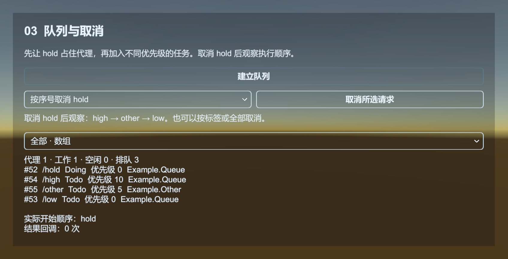

# WebRequest：发出 HTTP 请求

WebRequest 将 HTTP 请求排队，交给空闲代理执行，再通过 Event 返回结果。默认 Helper 使用 UnityWebRequest，适合公告、版本信息和小份响应；下载大文件到磁盘用 [Download](download.md)。

[WebRequest 示例](../../Samples~/01_Modules/18_WebRequest/) 自带本机 HTTP 服务，可直接运行 GET、POST 和取消请求，并观察失败回调。

04_Post 在同一个界面比较 byte[] 和 WWWForm。回显区展示服务器收到的 Content-Type、请求体和解码内容；任务信息与回调上下文分别显示。可以输入中文、换行或 `+ & = %` 等字符，观察原始字节与表单编码的区别。

勾选延迟响应后，服务等待三秒再返回，便于取消。示例用任务序号取消当前请求，因此未设置 tag 时也能清理；销毁拥有者时同样只取消自己的任务。取消不会增加结果回调次数，之后可以重新发送。



## 请求一份本地 JSON

先在电脑上建一个测试目录，放入 `status.json`：

```json
{"message":"hello QGF"}
```

在这个目录运行 `python -m http.server 8000`。浏览器打开 `http://127.0.0.1:8000/status.json`，确认能读到文件。这个简单服务用于本机示例，不是登录或正式业务服务器。

场景中需要 Base、Event、WebRequest。WebRequest Inspector 应使用默认 UnityWebRequestAgentHelper，并至少分配一个 Agent。将下面文件保存到 `Assets/MyGame/Scripts/WebRequestExample.cs`，挂到 GameObject 上。运行后在脚本右键菜单点 Request status，Console 应输出 JSON。

```csharp
using System.Text;
using UnityEngine;
using UnityQGameFramework.Core.Event;
using UnityQGameFramework.Runtime;

namespace QgfDocs
{
    public sealed class WebRequestExample : MonoBehaviour
    {
        private EventComponent events;
        private WebRequestComponent web;
        private int serialId;

        private void Start()
        {
            events = QGF.Event;
            web = QGF.WebRequest;
            events.Subscribe(WebRequestSuccessEventArgs.EventId, OnSuccess);
            events.Subscribe(WebRequestFailureEventArgs.EventId, OnFailure);
        }

        [ContextMenu("Request status")]
        public void RequestStatus()
        {
            if (web == null || serialId != 0) return;
            serialId = web.AddWebRequest("http://127.0.0.1:8000/status.json",
                "Guide.Status", 0, this);
        }

        private void OnSuccess(object sender, GameEventArgs args)
        {
            var e = (WebRequestSuccessEventArgs)args;
            if (!ReferenceEquals(e.UserData, this) || e.SerialId != serialId) return;
            serialId = 0;
            Log.Info(Encoding.UTF8.GetString(e.GetWebResponseBytes()));
        }

        private void OnFailure(object sender, GameEventArgs args)
        {
            var e = (WebRequestFailureEventArgs)args;
            if (!ReferenceEquals(e.UserData, this) || e.SerialId != serialId) return;
            serialId = 0;
            Log.Warning(e.ErrorMessage);
        }

        private void OnDestroy()
        {
            if (web != null && serialId != 0) web.RemoveWebRequest(serialId);
            if (events == null) return;
            if (events.Check(WebRequestSuccessEventArgs.EventId, OnSuccess))
                events.Unsubscribe(WebRequestSuccessEventArgs.EventId, OnSuccess);
            if (events.Check(WebRequestFailureEventArgs.EventId, OnFailure))
                events.Unsubscribe(WebRequestFailureEventArgs.EventId, OnFailure);
        }
    }
}
```

停止本地服务器再请求一次，应进入失败分支。失败后 serialId 恢复为 0，可以重新发起请求。真机上的 127.0.0.1 指向设备自身；在设备上测试要改成电脑可访问的地址，并遵守平台的网络配置。

## 参数与返回值

`AddWebRequest` 返回本次任务序号，不是 HTTP 状态码。`tag` 便于整组查询或移除；priority 决定等待队列的任务调度优先级，不会打断已经执行的请求；UserData 用于把回调关联到拥有者。

| API / 事件 | 用法 |
| --- | --- |
| AddWebRequest(uri) | GET；另有带 tag、priority、UserData 的重载 |
| AddWebRequest(uri, WWWForm) | 按表单提交 |
| AddWebRequest(uri, byte[]) | 原始请求体，默认 Content-Type 为 application/octet-stream |
| WebRequestStartEventArgs | 某个 Agent 开始执行，区别于刚入队 |
| WebRequestSuccessEventArgs | 响应字节已就绪，使用 GetWebResponseBytes |
| WebRequestFailureEventArgs | 请求失败，读取 ErrorMessage |
| RemoveWebRequest(serialId) | 移除指定等待或执行中的任务 |
| RemoveWebRequests(tag) | 移除属于某个业务范围的一组任务 |
| GetWebRequestInfo / GetAllWebRequestInfos | 查看排队与执行状态 |

byte[] POST 会保留原始字节，包括二进制内容；它的默认 Content-Type 是 application/octet-stream。WWWForm POST 则由 Unity 编码字段。若服务器要求 application/json、认证头、PUT、PATCH 或响应头，需使用自己的 WebRequestAgentHelperBase。仅把 JSON 转为 byte[] 不会自动指定 JSON Content-Type。

Timeout 在 AddWebRequest 时保存到任务中，从代理开始执行计时。任务结束后的 GetWebRequestInfo.IsValid 为 false；移除等待或执行中的任务不会产生结果事件，应在取消处更新业务状态。已经排入 Event 队列的结果不会被撤回，回调仍需检查任务序号和当前业务状态。取消按序号、标签或全部任务时，框架会归还内部表单上下文，UserData 对象本身仍由调用方管理。

## 与其他模块如何协作

Core 的 WebRequestManager 使用任务池管理排队、超时和代理。Unity 组件创建 Agent Helper，并把 Core 事件转换成 Runtime 的 GameEventArgs，交给 EventComponent。请求不经 Resource，也不自动将响应写入 Config 或 DataTable；业务在成功事件里验证并转换响应。

组件的 Timeout 用于任务超时，Agent 数量控制并发。无可用代理的请求在队列等待。退出登录界面或销毁拥有者时，移除本业务请求并取消订阅，避免旧响应更新新界面。不要对共享 WebRequestComponent 调用 RemoveAllWebRequests 来取消一个面板的请求。

事件对象会被引用池回收，不要缓存 e；在处理函数中提取所需字符串或业务数据。错误日志不应输出登录令牌或密码。

源码：[WebRequestComponent](../../Runtime/Unity/WebRequest/WebRequestComponent.cs)、[UnityWebRequestAgentHelper](../../Runtime/Unity/WebRequest/UnityWebRequestAgentHelper.cs)、[Core WebRequestManager](../../Runtime/Core/WebRequest/WebRequestManager.cs)。
